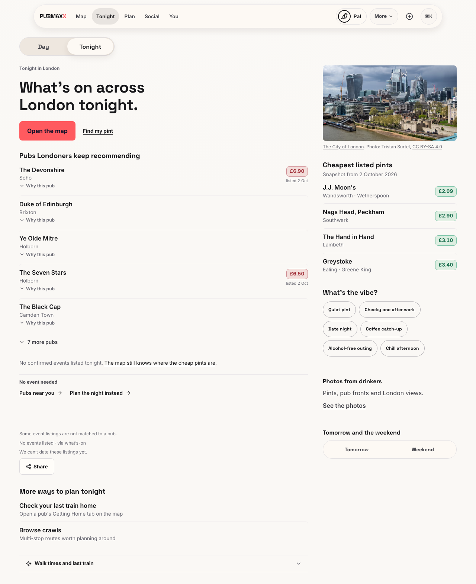
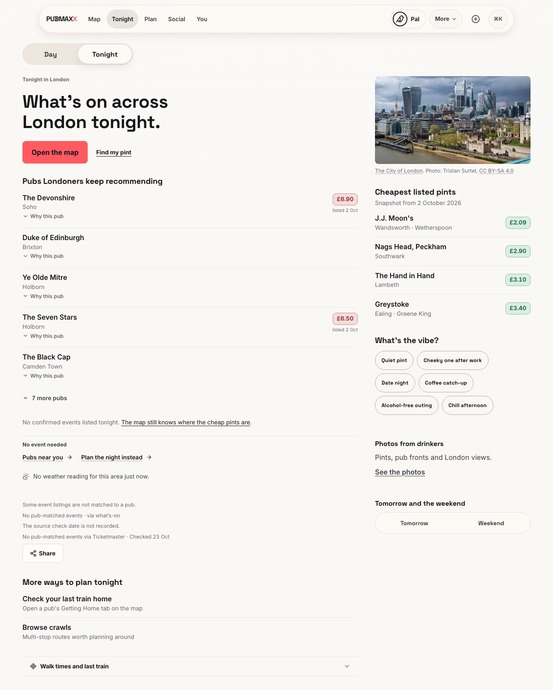
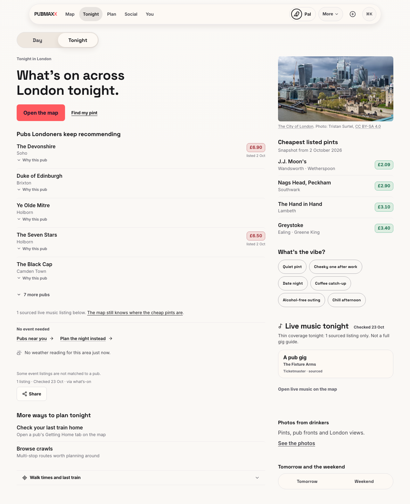
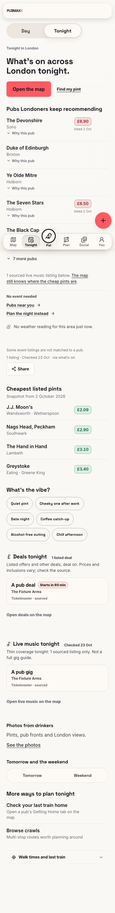
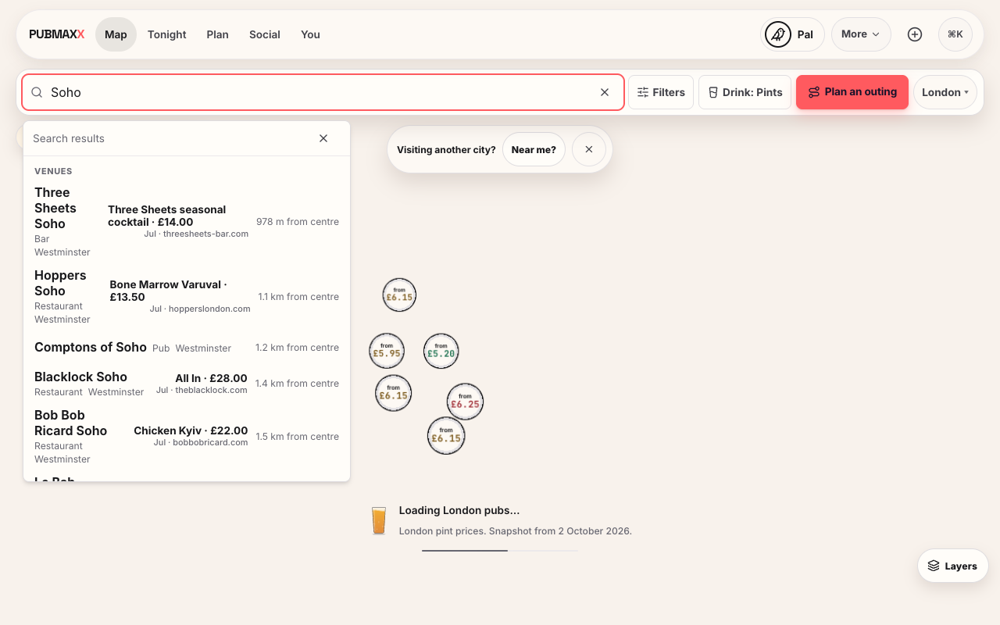
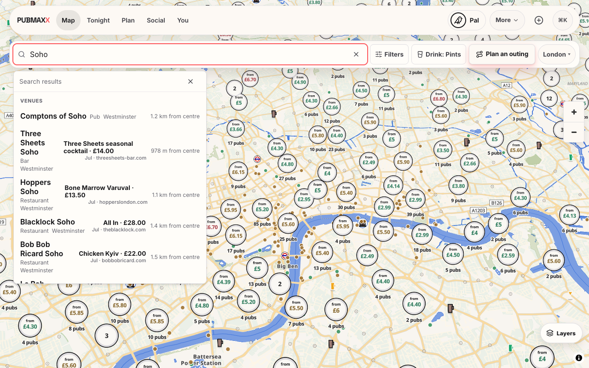
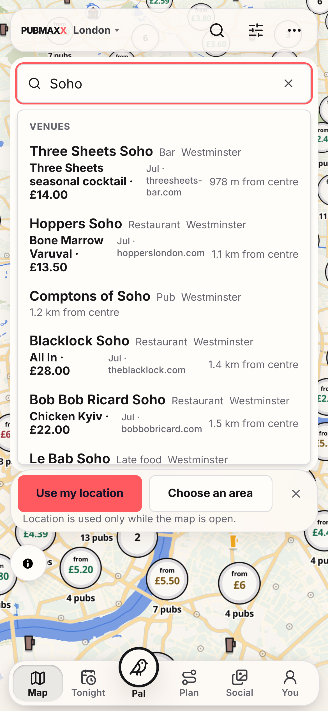
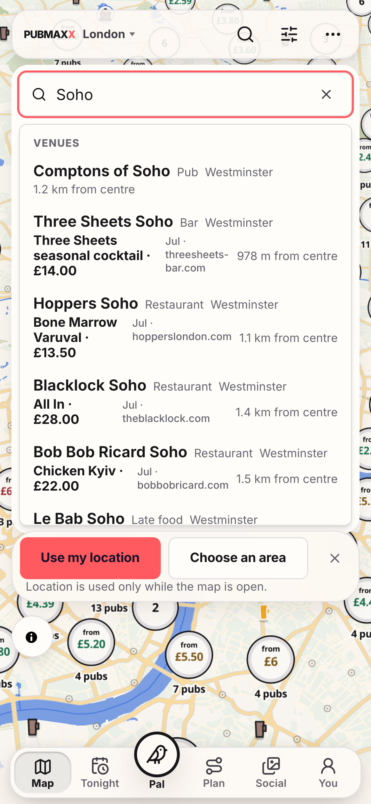
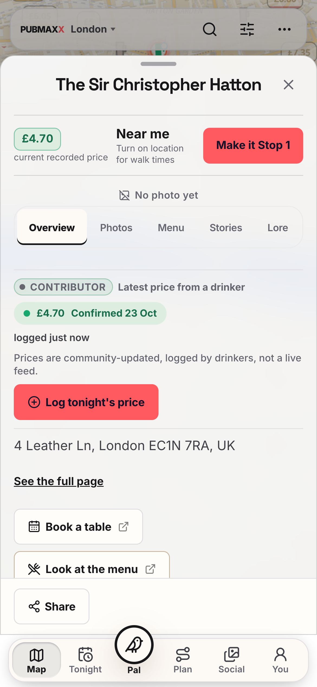

# Preview battle-test evidence, 23 October 2026

This record describes local changes based on `b58546dfe18ce2834e576e8378bf99cb6c475e04`.
It does not establish a new hosted deployment.
Karan reported that he had not applied the proposed build setting.

## Deployment receipts

| Target | Commit | Deployment | Evidence status |
| --- | --- | --- | --- |
| Live | `e81aaa6a04b720ddb8ef4b909b35ffad445b0088` | `dpl_H8cZfyzhPPUorvaNVF8hiddpwjxn` | Read-only hosted rerun |
| Existing preview | `ac48bbc4cc5fb4b6af34c80321e9cec2e110ff77` | `dpl_4eFUq4NCjXBfhCKBtUzCLSqEQrvU` | Read-only hosted rerun |
| Pinned main | `b58546dfe18ce2834e576e8378bf99cb6c475e04` | No accepted Git READY receipt | Local production build and fixtures |
| Candidate | This branch, based on pinned main | No accepted Git READY receipt | Local production build, browser tests and isolated database |

The existing preview used an explicit ignore-step bypass. It does not satisfy Git build acceptance.
The local branch `codex/preview/main-2026-10-23` points to the exact pinned main commit without an additional commit.
Its push remains pending the operator's setting change.
The [setting proposal](build-setting.md) contains the exact replacement and the subsequent acceptance checks.
There is no scheduler.

[Hosted receipts](hosted-receipts.json) contain deployment identities, API readiness, redirects, structured data, request counts and home figures.
[Browser settings](browser-settings.json) identify the viewport, iPhone UA and DPR used for hosted emulation.
The original pack's external evidence folder and scorer were unavailable on this machine.

## Findings

| Finding | Result | Evidence and limit |
| --- | --- | --- |
| F1, Git build path | Pending Karan | The read-only project check found `exit 0` and production branch `main`. The proposal is ready. No setting changed. |
| F2, release gap | Still present | Live remains e81aaa6. This work does not promote the preview fixes. |
| F3, restored map pins | Existing preview passes | Both viewport reruns retain surrounding venues and omit the city prompt. Live still fails. The candidate's restored-pin browser regression passes. |
| F4, Hatton search | Candidate passes locally | Both viewport UI checks show five relevant results. Existing main already contains the earlier matching fixes. |
| F5, close and reload | Existing preview passes | The focused rerun waits for `sel` removal before reload. The initial mobile capture reloaded prematurely and is retained separately. |
| F6, source check dates | Candidate fixtures pass | The empty pub result credits Out's checked provider. Missing source dates say they are not recorded. Event `startsAt` never supplies source freshness. Hosted copy remains unchanged. |
| F7, sourced music | Candidate fixtures pass | Both widths show one pub-matched music card, one displayed listing, no unmatched concert and no duplicate after tab changes. Hosted preview has zero music rows, so hosted music remains unverified. |
| F8, Updates | Candidate passes locally | The new entry uses the live release date, 22 October. It describes sourced menu updates and withheld unchecked listings from #2309, which live contains. It excludes #2321 and other preview-only changes. |
| F9, performance | See measurements below | The report separates local production measurements from the original confounded hosted timings. |
| F10, Pints ranking | Candidate passes locally | Soho shows Comptons before area-matched restaurants and cocktail venues at both widths. Unit tests preserve exact-name relevance and other drink modes. Price labels are unchanged. |
| F11, preview toolbar | Observed hosted noise | The preview's `vercel.live` script violates the existing CSP. No CSP or project setting changed. |
| F12, Confirm | Isolated local proof passes | Receipt-backed UI confirmation, persisted rows, refreshed API and sheet agree. Signed-out refusal and duplicate refusal pass. Hosted write proof remains unverified. |
| F13, opening picture | Emulation only | Street imagery and price bubbles appear in the captured phone map. The image is a CSS background. No physical phone proof exists. |
| F14, scorer | Replacement passes tests | The documented offline scorer counts canonical pub-matched API rows. Missing browser evidence remains UNVERIFIED. It does not claim compatibility with the missing original scorer. |

The live desktop Tonight request failed during the rerun. The scorer keeps that failure.
The live mobile and existing preview show an honest empty pub result.
The candidate's keyless local Out feed is not configured. Its real-feed Tonight acceptance is unavailable.
Fixture proof cannot replace that hosted dependency.

## Before and after

The same unmatched dated concert fixture reproduced F6 on pinned main before the change.
The candidate credits the checked Out source while retaining explicit uncertainty for the separate What's-on source.

| Before, pinned main | After, candidate |
| --- | --- |
|  |  |

Music proof uses fixtures at the required widths.

| 1280 pixels | 390 pixels |
| --- | --- |
|  |  |

### Soho Pints search comparison

The operator replayed the exact live `e81aaa6` source build locally to capture the baseline search order.
These baseline captures occurred after editing. They are not captures from the hosted live site.
The candidate captures came from `af246a4f`. Later Tonight fixes did not change Map ranking code.
Only the four named PNG files were copied from the operator's `artifacts/battle-20261023/` directory.

Both baseline captures show Three Sheets and Hoppers above Comptons.
Both candidate captures show Comptons first. The displayed cocktail and food labels stay unchanged.
The desktop baseline still shows the map loading, so this pair proves search ordering only.
The phone captures use a 390-pixel viewport. They do not establish physical-device behaviour.

| Width | Live source replay | Candidate |
| --- | --- | --- |
| 1280 pixels |  |  |
| 390 pixels |  |  |

The operator reported a later main commit, `d64a5cf0474407d51c7d2b521a7337c2c3f8c663`, after PR #2338.
This local test phase did not repeat that external check or change the pinned baseline branch.

## Isolated Confirm proof

The dedicated Colima profile and Supabase project are `pubmax-battle-1023` and `pubmax-battle-20261023`.
The app uses `http://127.0.0.1:3220`. Supabase uses `http://127.0.0.1:54321`.
Repository migrations ran only against this disposable local stack.
Two disposable accounts supplied separate receipt-backed reports for Hatton's £4.70 lager.
The receipt photo is a valid test fixture, not a real purchase receipt.

1. The first account seeded a £4.70 observation with HTTP 201.
2. A signed-out submission returned HTTP 403. The local handle ownership check refused it.
3. A duplicate same-day submission returned HTTP 409.
4. The second account used the signed-in UI and attached the required receipt image.
5. The write returned HTTP 201 with `confirmationOutcome.status` equal to `confirmed`.
6. Both persisted rows share a server-issued confirmation ID and date.
7. The refreshed API and sheet show the new confirmation date and £4.70.

[Sanitised write and persistence receipt](local-confirm.json).
This receipt and screenshot replace the initial local proof with the repeated loopback-only run.
The first Colima configuration forwarded Supabase on all host interfaces.
The operator stopped that VM, disabled automatic port forwarding, and restarted it with explicit `127.0.0.1` SSH forwards.
The repeated flow returned signed-out HTTP 403, duplicate HTTP 409, and a successful UI confirmation.
The saved receipt and screenshot show persisted confirmation and the updated sheet.
The repeated run recorded zero nonlocal writes.
The saved listener records show the [app](listener-3220.txt), [Supabase API](listener-54321.txt), and [database](listener-54322.txt) bound to loopback.
The corrected receipt includes two refreshed API rows from a later local GET capture at 12:57:14 UTC.
Their IDs, prices and confirmation dates agree with the persisted rows.
The first sanitised repeat receipt omitted these rows.
The local stack is stopped again. No hosted writes or migrations occurred.
The local stack omitted Realtime. Its broadcast failure did not prevent persistence or confirmation.
No hosted write proof is claimed because hosted database isolation is not established.



## Regression checks and source figures

Hosted requests recorded zero non-GET methods on both hosts and viewport sizes.
The captures recorded zero PostHog, ingest or event requests before consent.
The decline control hides the consent banner.
Both hosts retain Hatton's £4.70 report and `4 Leather Ln, London EC1N 7RA, UK`.
The report is dated 6 September. This work does not refresh the production observation.
Both hosts retain the home figures 942 / £5.55 / £4.19 / £1.36.
No price or home figure changed, so no new source claim is needed.
Both hosts retain BarOrPub JSON-LD on the ledger and the pub route's noindex and ledger canonical.
`/out` returns 308 to `/tonight`. `/you` returns 308 to `/u/you`.

## Validation

The local test repair reproduced the outdated rendered `Quiet night` expectation with exit code 1.
New regressions reproduced false dated credits for unnamed sources on both response paths and in the shared music-date calculation.
The repair preserves unnamed-source attribution and leaves a combined source date unknown when any row lacks check evidence.
The fixture uses a string for a missing row date and a known stale checked-time string in the source map.

The focused command below exited 0 with 121 tests passing across four files.
The configured changed-file command was not repeated because this phase prohibits its lint and static analysis steps.
The reported type error therefore has no new compiler verification from this phase.
Existing browser evidence remains unchanged. No new browser or hosted run occurred during this repair.

```sh
OPENROUTER_API_KEY= node_modules/.bin/vitest run __tests__/tonightInitialOutAnswer.test.tsx __tests__/tonightHypedLede.test.ts __tests__/tonightMusicLaneDate.test.ts __tests__/tonightOutListings.test.ts --maxWorkers=2
```

The following checks describe the earlier implementation run, before this local test repair.

- Targeted regression tests passed, including 363 tests across nine files.
- The selected Chromium browser suite passed all ten tests.
- The music suite passed again after setting the desktop viewport to exactly 1280 by 800.
- `npm run verify` passed with 43,412 unit tests, 681 PostgreSQL tests and ten additional integration tests.
- Verification retained one pre-existing skipped unit test, ten lint warnings and the existing advisory freshness findings.
- The final `NEXT_DIST_DIR=.next-battle-final` production build passed with Next.js 16.4.1.
- No page/API ceiling increased. Existing endpoints and response envelopes are unchanged.

Verification found existing test isolation failures and one unused exported type.
The fixes isolate generated provider data and inherited OpenRouter credentials from fixed fixtures.
Those small fixes overlap equivalent repairs in open PRs #2337 and #2338.
No product behaviour from those PRs was copied.

Raw captures, API responses, console output, request methods and measurement scripts remain in the owning worktree's ignored `artifacts/battle-20261023/` directory.
Disposable sessions and credentials are excluded from this public proof.
The shared stale checkout and other owners' work remain intact.

## Local production performance

All values below are milliseconds. Each cell is the median of five measured runs.
The runs alternate live and candidate, with a fresh Chromium context per run and one excluded warmup.
Both use desktop 1280 by 800, software WebGL, denied analytics consent and the same external-request block.
The builds use separate directories and ports, 3219 and 3218.
Both are keyless and use committed source data. No Vercel toolbar runs locally.
There is no CPU or network throttling. These are localhost measurements, not real-user Web Vitals.

| Route | Metric | Live e81aaa6 | Candidate | Change |
| --- | --- | ---: | ---: | ---: |
| `/` | FCP | 104.0 | 100.0 | -3.8% |
| `/` | LCP | 104.0 | 100.0 | -3.8% |
| `/` | LOAD | 103.7 | 100.9 | -2.7% |
| `/map` | FCP | 64.0 | 64.0 | +0.0% |
| `/map` | LCP | 396.0 | 400.0 | +1.0% |
| `/map` | LOAD | 72.5 | 73.2 | +1.0% |

[Final samples](performance-final.json) retain all five runs. No final median regression exceeds 10%.
The [first series](performance.json) showed home FCP and LCP +20.9%, and load +28.7% during concurrent validation.
Those results remain recorded. The final series ran after our builds and verification finished.
The evidence does not establish a persistent regression or a single code cause.

The [diagnostic series](performance-diagnosis.json) compares untouched main and candidate, then isolates two suspected commits.
Untouched main and the candidate showed similar home timings.
The #2336 dependency comparison had identical 88 ms FCP medians before and after.
The #2335 stylesheet comparison first showed 88 to 100 ms FCP during another build.
Its repeat after the build showed 88 to 80 ms. That result does not support a stable stylesheet regression.
Shared-machine scheduling remains a measurement limitation. No performance budget increased.
Hosted measurements remain separate because edge state and the preview toolbar differ.
