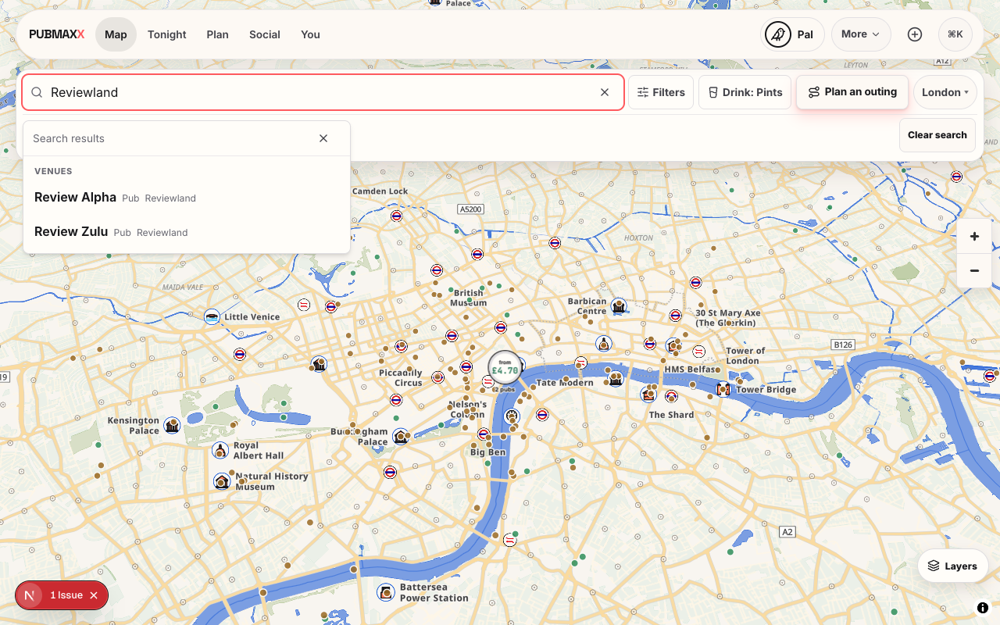
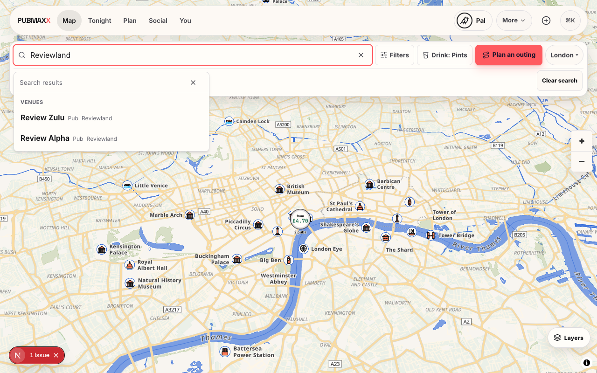
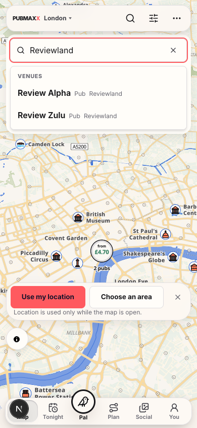
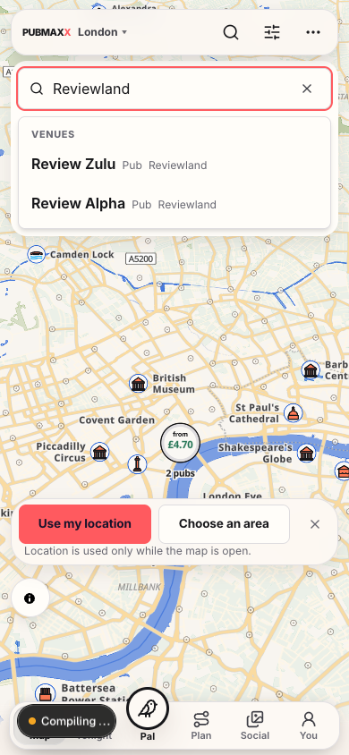

# Known price evidence follow-up, 23 October 2026

This record addresses [Bugbot's representation finding](https://github.com/Singularityszn/pubmax/pull/2339#discussion_r4362237825).
The before captures use the development bundle compiled from `41b04f278031e1d14cebd30722ca303e3365f6a8`.
The after captures use the working fix in a restarted private development server.
They are local fixtures at 1280 by 800 and 390 by 844. They do not establish hosted or physical-phone acceptance.

## Reproduction

The real `/map` UI receives two synthetic pubs through intercepted core and cell packs.
A sourced-price fixture supplies Review Zulu's £4.70. The compact search snapshot has no prices.
The fixture uses `https://example.com/menu` as a test source. It is not a real pub-price claim.
Both pubs remain loaded while the query changes.

1. Search for `Review`. Review Zulu displays £4.70 and leads the unpriced Review Alpha.
2. Search for `Reviewland`. Both pubs have equal area relevance and use indexed rows.
3. Before the fix, Review Alpha leads despite Review Zulu's known price.
4. Return to `Review`. Review Zulu still displays £4.70, confirming that its loaded evidence remains available.

The first probe used the wrong source-file path and is excluded from the accepted captures.
The corrected fixture intercepts `/data/price_updates/latest.json`.
The first after attempt still received the old development bundle. A fresh server supplied the fixed bundle.
Raw attempts remain in the owning worktree's ignored artifacts and temporary logs.

## Change and regression checks

The merge now reads a known venue's price regardless of its row representation.
The index receives the same current price priority before its result limit.
Unknown venue IDs retain their compact evidence. Other drink modes retain their existing order.
Price labels, endpoints and response envelopes are unchanged.

The merge regression failed before its fix. A rendered-component regression then exposed truncation before the merge.
The focused run passed 82 cases across four existing search test files.
It covers a known priced area match beyond twelve compact results, keyboard focus, price removal, and Wine ordering.
The TypeScript check and scoped lint passed.
The persistent browser specification passed all four cases, including the new sourced-price fixture at both widths.
Final production-build and CI receipts belong in the PR's final validation section.

| Width | Before | After |
| --- | --- | --- |
| 1280 |  |  |
| 390 |  |  |
