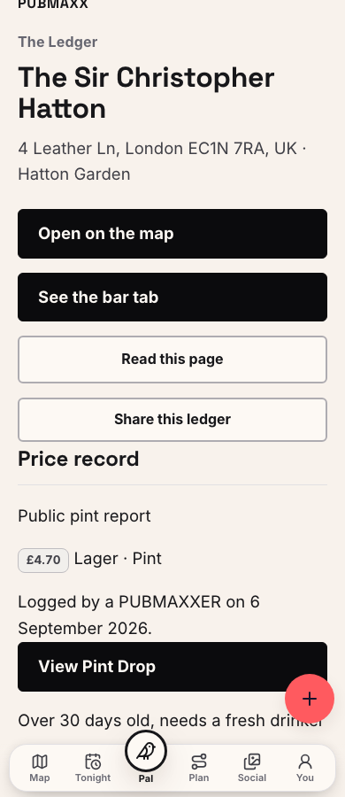
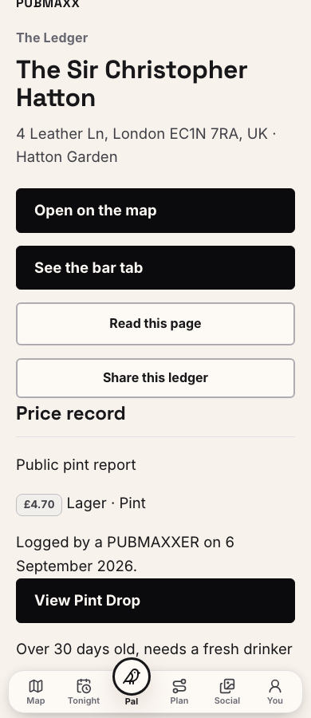

# Browser acceptance, 25 October 2026

This lane adds browser regression coverage and a narrow Ledger chrome repair.
Its starting commit is `a87240e748c859556b3604db508db257af96ca03`.
The branch is `codex/battle-browser-hygiene-1025`.

## Evidence

The browser used local Chromium at desktop 1280px and phone 390px widths.
The private development server used port 3217 and this lane's installed dependencies.
The initial results below came from development mode.
The later production-build checks are recorded separately below.
Neither establishes hosted, physical-device or real-provider authentication acceptance.

| Finding | Observed result |
| --- | --- |
| F10 | Existing Pints ranking tests passed for priced pubs, unpriced pubs, bars and restaurants at both widths. Both Riverside index-truncation cases passed. |
| F18 | The existing signed-in import review and save test passed at 390px. New tests verify the signed-out gate, failed matching, preserved text, retry, cleared input and keyboard focus restoration at both widths. |
| F19 | New tests navigate Home, Tonight and Home before denying analytics. The decision remains denied through `/map?log=1`, Tonight, Home and reload at both widths. |
| F20 | New tests open and close the first native `Why this pub` disclosure with Enter at both widths. The explanation becomes visible. |
| F21 | New coverage collects actual internal links from Home, Tonight, Plan and Credits. Each collected target resolves below HTTP 400 through GET. |

The import tests use the repository's provider-shaped browser authentication doubles and intercepted import responses.
They do not contact a production account or save a real night draft.
F4 and F5 retain the coordinator's earlier read-only evidence and existing regressions.
This lane does not replace that evidence or claim a fresh run of those journeys.

## Verification limits

The complete new spec passed all seven cases in 54.6 seconds.
The final link-receipt run checked 64 unique internal targets. All returned HTTP 200.
The existing import review test also passed, and the four selected Pints ranking cases passed across focused runs.
ESLint and `git diff --check` passed for the changes.

Cold development compilation restarted the server during initial browser attempts.
An initial desktop ranking attempt exceeded its 30-second budget.
The unchanged test passed in 22.2 seconds with a 120-second invocation budget.
The consent test initially inherited the suite's returning-visitor denial.
It now clears that choice once and waits for real route hydration before navigating.

The initial handoff left full verification, the production build and publication with the coordinator.
The coordinator later returned this lane for the bounded chrome repair and its own verification and publication.
No merge, production deployment, settings change or migration occurred in this lane.

The first local keyless Ledger check lacked the public report.
A later public-response replay against the Ledger lane's production build, `6e39c78c32f405294bf4f90b03c10d1b4e86b0be`, reproduced the overlap at 390 by 900.
At scroll offset 36px, the warning occupied `(20,799,350,29.7)` and Create occupied `(322,761,56,56)` with opacity 1.
The regression failed because the warning's final word did not own its hit target.
At scroll offset 336px, the existing scroll behaviour correctly hid Create.
The repair uses the existing visibility policy to omit the generic control on Ledger routes.
It preserves Ledger's own actions and the global scroll behaviour.
The new browser test checks the warning's real hit target and the existing links at phone and desktop widths.
The original run recorded the failing browser result under `artifacts/fab-overlap/red`.
It recorded the measured boxes and screenshots under `artifacts/fab-overlap/before.json` and its sibling images.

## Production-build check

The isolated `.next-hygiene-prod` build passed.
Its local `/api/version` reports `ac3e5b1b1de4cebbb87f04954fb15deb168ee8f1`.
Chromium passed all ten browser cases against that build in 8.5 seconds.
These include the seven initial checks, both Ledger hitbox checks and the existing full import review/save case.
The production-build link crawl again returned HTTP 200 for all 64 targets.
All import writes remained intercepted local fixtures.
The four selected Pints ranking cases also passed against this build in 10.7 seconds.

The before image uses the Ledger lane's production build with the captured public response.
The after image uses this lane's production build with the same public pint fields in a minimal browser fixture.
Both show a 390 by 900 viewport after a 36px scroll.

<!-- before-and-after:start -->
| Before (Ledger at 390px) | After (Ledger at 390px) |
|:---:|:---:|
|  |  |

<!-- before-and-after:end -->

## Full verification

`npm run verify:no-mistakes` passed on the committed repair.
This runs the complete `npm run verify` with the repository's committed-data wrapper.
It passed 43,856 unit tests, with one existing skip, 697 PostgreSQL tests and 10 serial PostgreSQL harness tests.
Lint, schema types, TypeScript, public-map checks, dead-code checks, coverage, browser-skip policy and install-script policy passed.
Lint retained three existing complexity warnings in unrelated auth and Pub Pal code.
The audit found no high or critical vulnerabilities.
Freshness retained two stale datasets and three unmeasurable store feeds as advisory findings.
Those datasets and feeds are not reported fresh.

The original run recorded raw screenshots and browser results under `artifacts/hygiene-*`.
The ignored `artifacts/` directory is not included in this checkout.
The link test writes its exact GET receipts and attaches them to the Playwright result.
