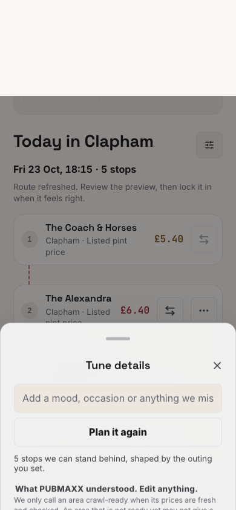
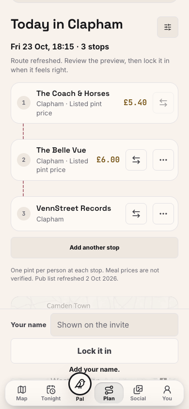

# Mobile pub, price, plan and guest flow

This is a dated record from 23 October 2026. The viewport was 390 by 844 pixels in Chrome.

## Live observations

The live deployment reported commit `e81aaa6a04b720ddb8ef4b909b35ffad445b0088`.

1. The central London fallback found Hercules Pillars with a listed £4.20 pint.
2. The pub sheet showed Pint Prices as the source and 2 October as the read date.
3. Accepting the pub preserved it as Stop 1 in the planner.
4. Asking for three pubs with short walks returned an honest `anchor-only` API result.
5. The composer incorrectly reported a successful refresh and reduced the Stops control to one.
6. Removing the walking phrase still sent the previous walking constraint in the next request.

A separate Clapham plan completed the live sharing flow. The Coach & Horses showed £5.40 with the same source and date. The three-pub route included a pub without a listed price, so the app omitted the total.

The host saved the plan and opened its invite in a fresh guest browser. The preview hid the venue names. Entering a name and joining revealed all three pubs immediately. No account or reload was needed. No WhatsApp message was sent.

| Guest preview | Guest after joining |
| --- | --- |
|  |  |

## Changes and regression checks

The composer now explains an incomplete route and keeps the requested stop count. Editing or clearing the description refreshes its transport requirements. Explicit transport overrides and recovered drink, food and atmosphere choices remain intact.

The browser regression uses the real local API and an isolated production build. It starts at Clapham, checks a pub price and its source, reproduces the incomplete result, removes the walking requirement, saves three stops and joins through a fresh guest context. It also checks guest-page horizontal overflow.

The browser test is `e2e/mobile-price-plan-guest.spec.ts`. The component and request-boundary tests failed before their respective fixes.

The final production-build browser run passed in 7.6 seconds after the build. It used system Chrome because the pinned Playwright browser was absent. The test used a private local port and a separate Next.js output directory.

The local guest can dismiss the optional account prompt with **Not now**. The test dismisses that prompt when present, scrolls to the route and checks that a pub link is usable. The screenshots below show the route after that check.

| Incomplete result after the fix | Guest after joining the local plan |
| --- | --- |
|  |  |

The full gate also exposed an unused test-helper type export and an hours evaluator that depended on changing enrichment. The type is now private. The hours evaluator fixes Google Places as absent while testing its existing missing-hours and website-evidence cases. Production hours data is unchanged.

The local build evidence does not establish a production deployment of these fixes.

## Stop-count recovery repair

This repair used the working tree based on `7bf4e11f514e97e1f98641f9d89a853d45b678db`.

The original Chrome flow reproduced the reported failure. A five-pub request returned `anchor-only`. Clearing the description omitted `context.stopCount`, and the API inferred three stops. The new request tests failed before the fix in all twelve empty-text and whitespace cases across counts one through six.

The shared request builder now retains the displayed count for blank text. Explicit controls and intake answers still take precedence. A new nonempty description still uses fresh count inference. Transport requirements still follow the current description.

The focused request and composer run passed all 215 tests across six files. Lint exited successfully with 11 warnings in unchanged files. The changed source and tests passed ESLint with `--max-warnings=0`.

Both tests in `e2e/mobile-price-plan-guest.spec.ts` passed against a fresh production build using system Chrome. The run used private port 43189, `.next-ci-stop-green`, local dependencies, one worker and zero retries. The original price, plan and fresh guest flow passed in 8.6 seconds. The count-recovery flow passed in 4.0 seconds. Build and browser execution took 1.7 minutes together.

The [recorded request and response fields](stop-count-request-evidence.json) come from the browser network traces. A null request field in this record means that the request omitted it. After clearing, the repaired request sent five stops and the API inferred five. A new three-pub description then inferred three stops. Screenshots show the resulting states.

| Cleared description retains five stops | New description requests three stops |
| --- | --- |
|  |  |

The ignored `artifacts/mobile-stop-count/` directory contains the local logs, temporary Chrome configuration and browser traces.

The cancelled layout workflow on the old head has no passing verdict. The outer executor must obtain a fresh full browser layout verdict for the repaired head. This local evidence does not establish a production deployment.

The full local `npm run verify` gate passed after the repair. Coverage passed 43,174 tests with one existing skip. Database tests passed all 690 cases. Type checking, dead-code checks, the browser-skip check, install-script policy and dependency audit passed. Freshness passed with two advisory stale datasets and three unmeasurable feeds. Those datasets were not reported fresh. The complete gate output is `artifacts/mobile-stop-count/verify.log`.
