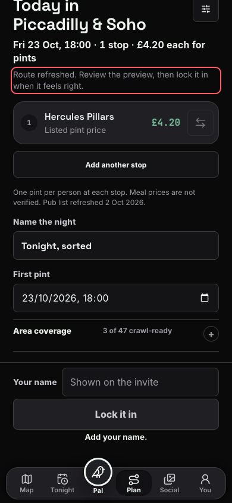
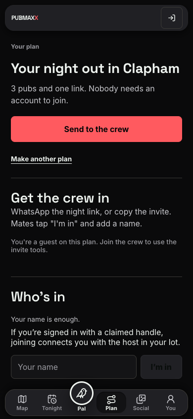
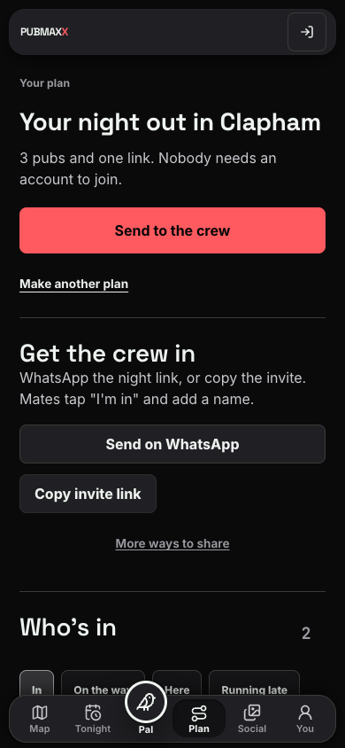
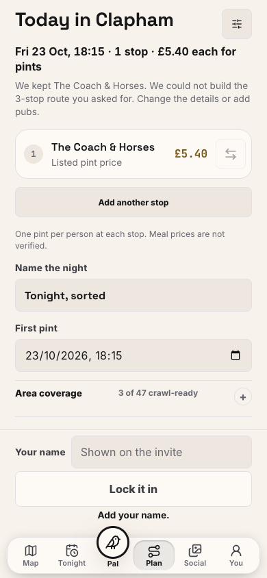
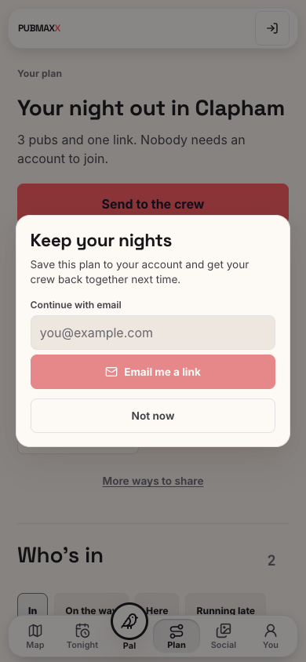

# Mobile pub, price, plan and guest flow

This is a dated record from 23 October 2026. The viewport was 390 by 844 pixels in Chrome.

## Live observations

The live deployment reported commit `e81aaa6a04b720ddb8ef4b909b35ffad445b0088`.

1. The central London fallback found Hercules Pillars with a listed £4.20 pint.
2. The pub sheet showed Pint Prices as the source and 2 October as the read date.
3. Accepting the pub preserved it as Stop 1 in the planner.
4. Asking for three pubs with short walks returned an honest `anchor-only` API result.
5. The composer incorrectly reported a successful refresh and reduced the Stops control to one.
6. Removing the walking phrase still sent the previous walking constraint in the next request.

A separate Clapham plan completed the live sharing flow. The Coach & Horses showed £5.40 with the same source and date. The three-pub route included a pub without a listed price, so the app omitted the total.

The host saved the plan and opened its invite in a fresh guest browser. The preview hid the venue names. Entering a name and joining revealed all three pubs immediately. No account or reload was needed. No WhatsApp message was sent.

| Guest preview | Guest after joining |
| --- | --- |
|  |  |

## Changes and regression checks

The composer now explains an incomplete route and keeps the requested stop count. Editing the description refreshes its transport requirements. Recovered drink, food and atmosphere choices remain intact.

The browser regression uses the real local API and an isolated production build. It starts at Clapham, checks a pub price and its source, reproduces the incomplete result, removes the walking requirement, saves three stops and joins through a fresh guest context. It also checks guest-page horizontal overflow.

The browser test is `e2e/mobile-price-plan-guest.spec.ts`. The component and request-boundary tests failed before their respective fixes.

The final production-build browser run passed in 5.4 seconds after the build. It used system Chrome because the pinned Playwright browser was absent. The test used a private local port and a separate Next.js output directory.

| Incomplete result after the fix | Guest after joining the local plan |
| --- | --- |
|  |  |

The full gate also exposed an unused test-helper type export and an hours evaluator that depended on changing enrichment. The type is now private. The hours evaluator fixes Google Places as absent while testing its existing missing-hours and website-evidence cases. Production hours data is unchanged.

The local build evidence does not establish a production deployment of these fixes.
