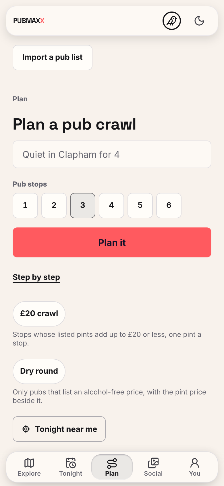
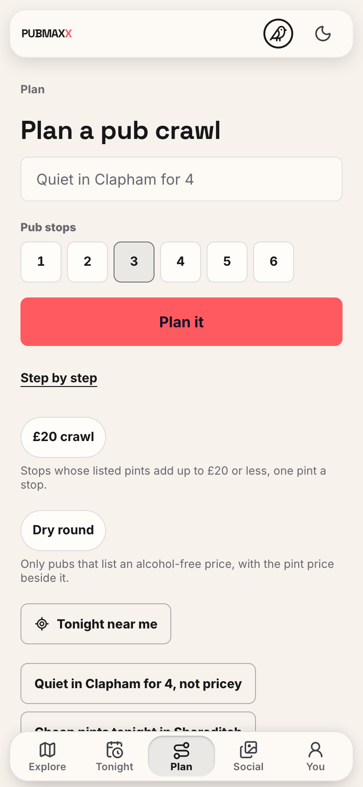
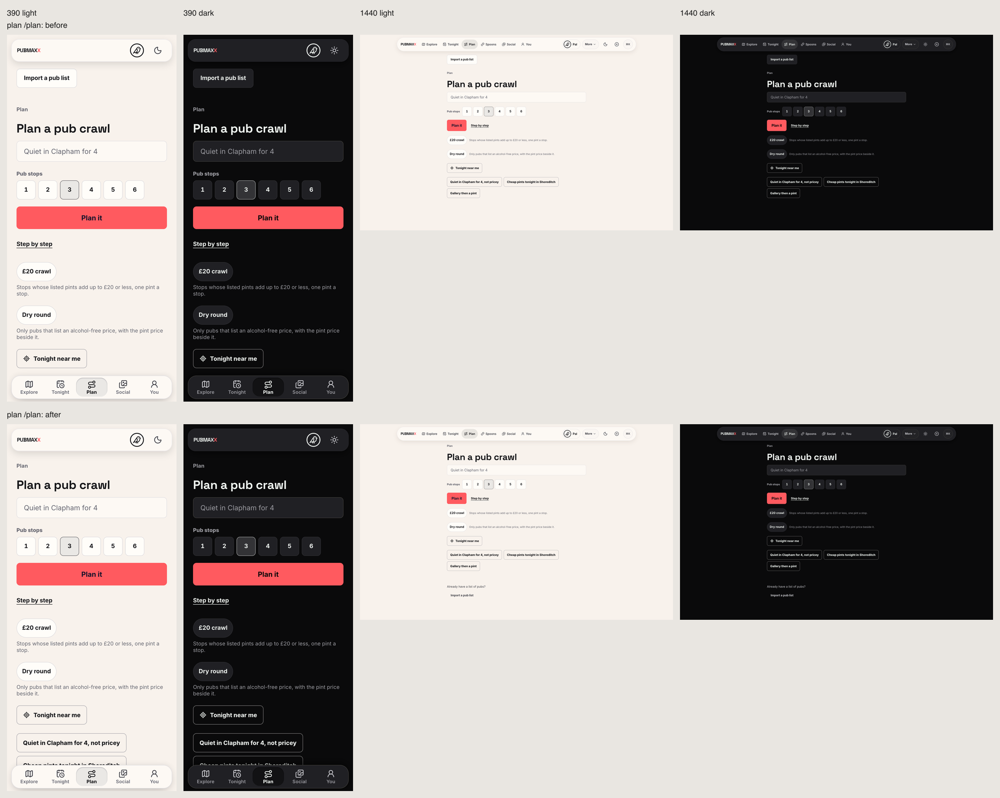

# Plan describe-first browser record

This record was captured on 3 November 2026.
The before build is `35cc1a7d786d3e71cdc0a942aa6b85ec89418d15`.
The after build is `093cce4ec4fe0ddaaf2c6a2e54e42176daf7ac3e`.

The after screen places the description and primary action before the import door.
The import door retains its modal and focus-return behaviour.

The contact sheet contains Chromium captures at 390 x 844 and 1440 x 900 in both stored themes.
Both builds use private local production servers and anonymous browser contexts.

| Before at 390 px | After at 390 px |
| --- | --- |
|  |  |

The captures use `npm run proof:design` with the page argument `plan=/plan`.
Full local `npm run ci` passed on the after head.
The branch has 46,594 passing unit tests, one existing skipped unit test, and 782 passing database tests.
The existing baseline lint and file-tracing warnings have separate repair branches.
