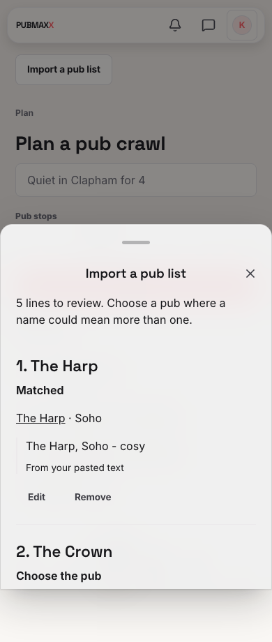
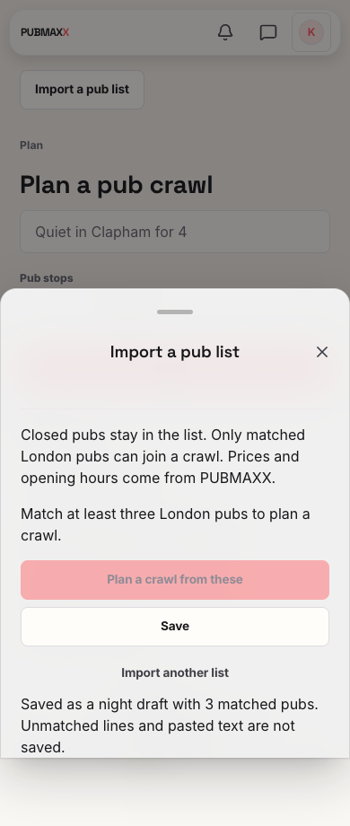

# Pub list import review

Before this change, the branch contained the matching endpoint without an import interface.
The Plan page now opens an editable review sheet and retains private night drafts.

The screenshots show the local development app at 390 by 844 pixels with reduced motion.
The browser spec uses representative pubs, a mocked signed-in account and mocked import responses.
It checks all match states, candidate selection, line edits, removal, keyboard saving, focus return and axe.
The development indicator is hidden only for the screenshot.

The unit tests exercise matching, the exact imported route and its existing grounding proof.
The permission matrix checks the API and database as the owner, another account and an anonymous reader.
It also checks the migration rollback in a disposable database.

Migration 0195 and its rollback are SQL files. No live database received them.
The generated database types came from the repository generator and a disposable database.

The original 21-pub caption was not supplied. No live model request or native screen-reader session formed part of this proof.
