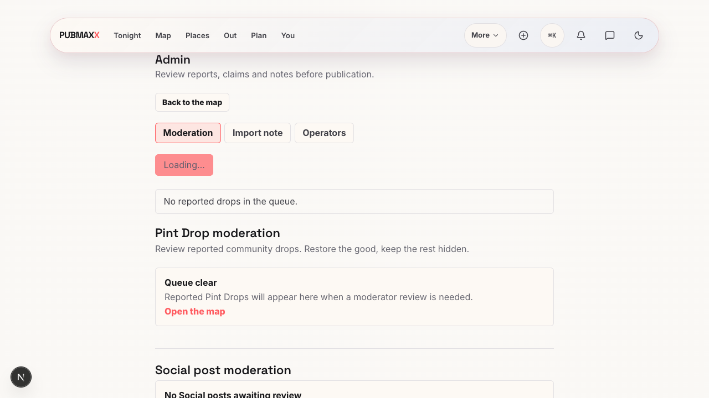
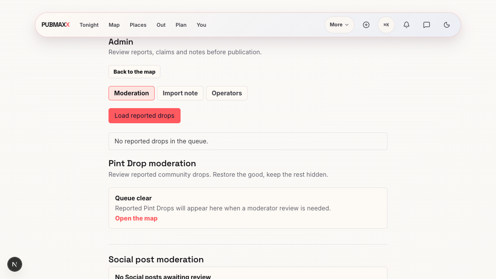

# Recovery and skipped-test audit, 11 October 2026

This record describes local evidence from main `85512d7bf` and this recovery branch. It does not prove a deployment.

## Admin recovery

A real Chrome journey reproduced a disabled full-load control after Social session recovery. The test delays Pint Drop responses, expires the Social session, and re-enters the token through the real admin session route. Social recovery succeeds, but the original full load remains at `Loading…` after every queue response completes.

The full load and Social recovery shared a request generation. Recovery changed that generation, so the full load's `finally` block never cleared its loading state. A synchronous ref now serializes full-load entry. The full load clears its own busy state regardless of Social recovery's generation.

| Before | After |
| --- | --- |
|  |  |

The new browser regression failed before the fix and passed afterward. It also verifies that a subsequent full refresh completes. The existing rapid-retry component test now requires one session check as well as one Social read. All 22 moderation component tests passed.

The browser used installed Chrome, the repository's Playwright package, a private Next development server on port 32189, and mocked moderation queue responses. The admin token submission used the real route. This is development evidence, not production-build evidence.

## Hidden PostgreSQL skips

Two messaging migration suites had extra private opt-out flags outside the shared PostgreSQL skip policy. With both flags set, Vitest exited 0 while skipping all 22 tests. After removal, the identical command executed all 22 tests and passed against disposable PostgreSQL 16 clusters.

```sh
PUBMAX_MESSAGE_IDEMPOTENCY_NO_PG=1 PUBMAX_MESSAGING_REALTIME_NO_PG=1 npx vitest run __tests__/messageIdempotencyMigrationEffective.test.ts __tests__/messagingRealtimeAuthorizationMigrationEffective.test.ts
```

The documented global opt-out remains subject to the shared runner's explicit skip-admission policy.

## Remaining proof gaps

Issue #1300 remains open. Its signed-in Plan capability recovery test still skips unconditionally. The shared auth helper exists, but its browser doubles cannot supply verified server identity. A real local PATCH with a fixture bearer and idempotency key returned HTTP 503, `PLAN_ACCOUNT_RECOVERY_UNAVAILABLE`, from the keyless server. Docker was stopped, so isolated Supabase Auth was unavailable. No product authentication bypass was added.

Issue #1313's original stale full-load overwrite scenario was not separately reproduced. The full-load serialization protects the entry it names. The confirmed session-recovery lockup is related evidence, not proof that the original scenario occurred.

The Gate Z performance spec has an opt-in flag but no npm command or workflow sets it. This finding was sent to the performance owner. It is a missing proof owner, not evidence of a performance defect.

## Intentional exclusions

| Test condition | Owner |
| --- | --- |
| Shared PostgreSQL opt-out | `npm run test:rls`, CI PostgreSQL job |
| SysV harness serial phase | `scripts/rls/postgresSuites.mjs` |
| Nightly performance budget | `.github/workflows/performance.yml` |
| Failure-only performance A/B | `scripts/perf-ab.mjs` |
| Manual Core Web Vitals | `npm run perf:cwv-sweep`, `perf:cwv-record` |
| Social open rollout | `docs/SOFT_LAUNCH_RUNBOOK.md` manual command |
| Live Pub Pal voice | `docs/PUB_PAL_SETUP.md` credential-based run |
| Screenshot viewport cases | `npm run shots`, `shots:extended` |
| Signed-in production smoke | Production workflow requires credentials |
| Disposable Plan database | `scripts/e2e/run-disposable-plan-browser.mjs` |
| Real authenticated review | Opt-in authenticated Playwright project |

The Node import probe and cached-Overpass refusal test were active on this host. The inventory found no test `todo`, `fixme`, `only`, or quarantine markers. Project routing keeps WebGL, keyless, screenshots, authenticated review, and production smoke in their intended runs.

Focused lint and the browser skip source gate passed. Full verification and production-build evidence were pending at this record's creation.
