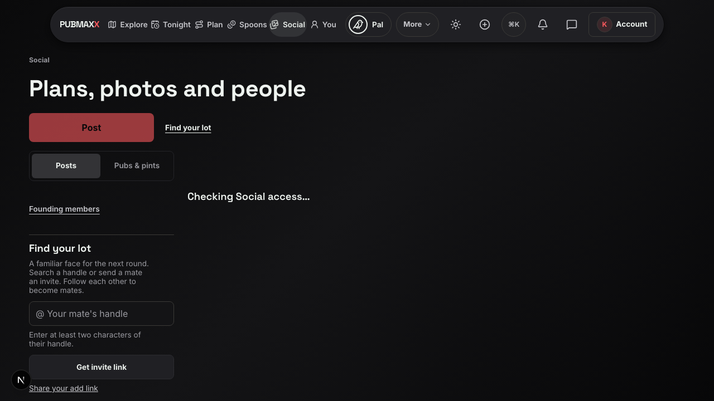
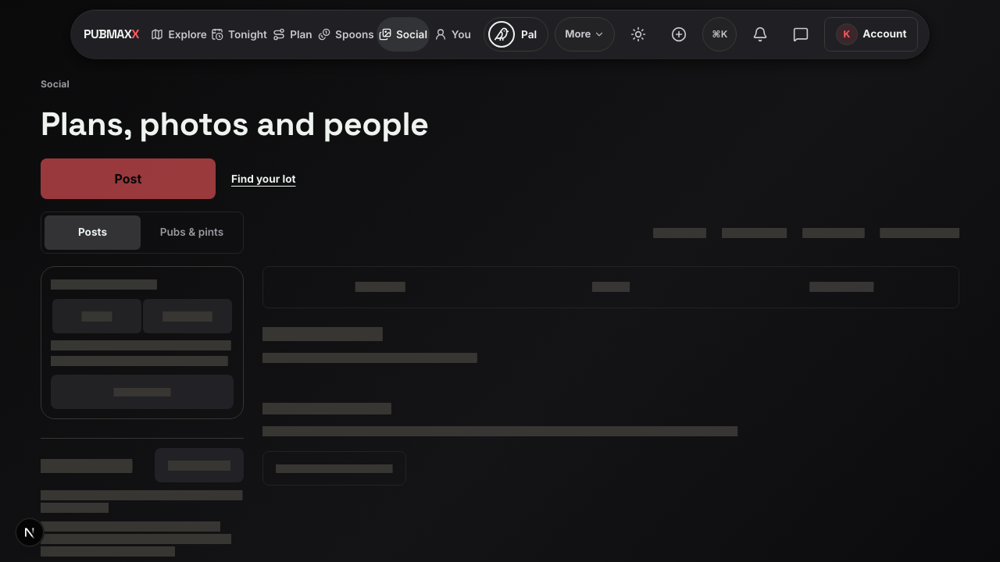
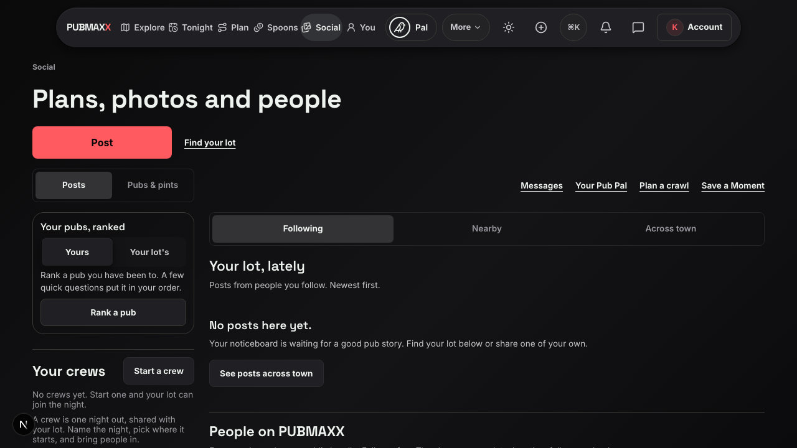

# Social layout evidence, 5 November 2026

The Social page previously inserted controls and cards after account access resolved.
Empty tag lanes briefly appeared during loading.
Activity also added a desktop grid column, which changed the feed width.

The repair reserves space with inert samples of the real cards.
Sampled cards do not request protected data.
Activity stays in the existing sidebar, and empty loading lanes remain absent.

## Browser measurements

These local Chromium measurements use the development server and disposable account fixtures.
There is no CPU or network throttling.
The desktop viewport is 1280 × 720. The phone viewport is 390 × 844.
The existing vitals helper sums layout shifts without recent user input.
The regression limit is 0.10.

| Case | Before | After |
| --- | ---: | ---: |
| Desktop empty feed, matching captures | 0.181282 | 0.023560 |
| Phone empty feed | Not measured in this pair | 0.027288 |
| Desktop populated feed and Activity | Not measured in this pair | 0.060098 |
| Desktop arrival from the map | Not measured in this pair | 0.019695 |

An earlier desktop reproduction measured 0.360751 before the repair.
Nine repeated repaired cases measured 0.026310 to 0.062869 before the final fixture correction.
The final fixture correction supplied the reaction-summary response expected by the real post card.
The final four cases all passed.

The regression also checks that pending samples make no protected Social requests and expose no usable ranking control.
The focused account, rollback, placeholder, and Social unit checks passed 53 tests.
Full project verification and publication checks are recorded in the PR.

These lab results do not establish the Vercel field score or a production improvement.
No production build or deployment formed part of this proof.

## Matching screenshots

Both captures hold the access response before releasing the same empty account fixture.
The before server uses commit `445df3a6bc85f2403f984a5f4a32e3e62d9731ff`.
The after server uses this repair.

| State | Before | After |
| --- | --- | --- |
| Access pending |  |  |
| Feed ready |  |  |

## Reproduce

Start an isolated development server with the environment exported by `playwright.config.ts`.
Use the port of that server in the command below.
The skip flags reuse that server and prevent an automatic production build.

```sh
PW_PORT=4715 PW_SKIP_WEBSERVER=1 PW_SKIP_KEYLESS_WEBSERVER=1 npx playwright test e2e/social-layout-stability.spec.ts --project=chromium --workers=1
```
