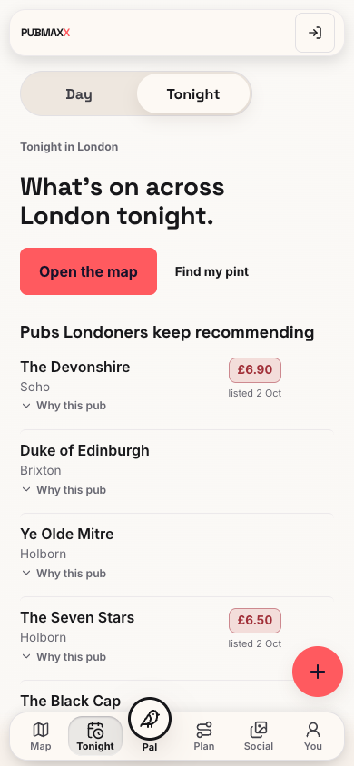
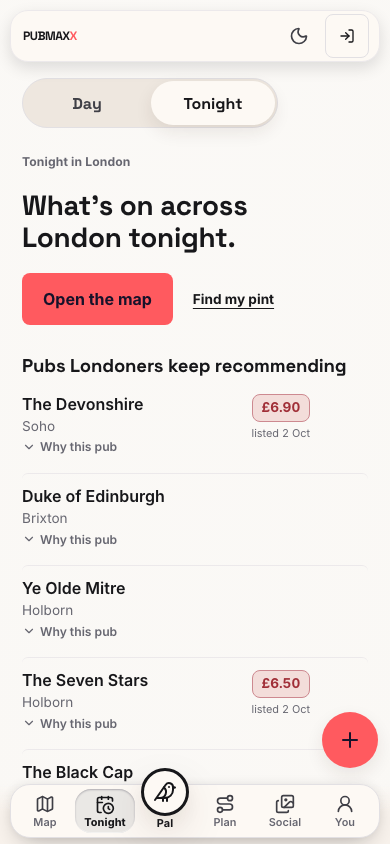
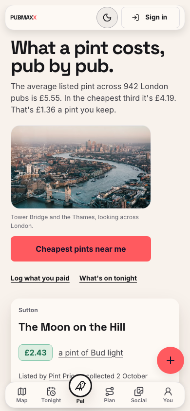
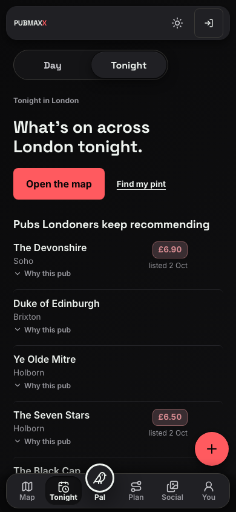

# Theme button restoration

The shared header again exposes the sun and moon theme button on Home and app pages.

## Cause and reproduction

Commit `594940a80355fc116d530e7be138fa9880af05b7` removed the header button on 16 October.
It moved the theme choice to the desktop More menu and the You page's Appearance setting.
Phones hide More, so a reader had to leave the current page to find the setting.

The live `/tonight` page reproduced the missing button at 390 by 844 pixels on 25 October.
The live version endpoint reported `0bb6fa2e4c0c04ac26db4a1b95305f2d47fb0559`.
The browser probe failed with `Missing visible theme button on Tonight mobile`.
The updated navigation test also failed before the repair because the header button did not exist.

## Repair

`SiteNavActions` renders the existing `ThemeToggle` on Home and app pages.
The desktop More menu no longer repeats the theme action.
The You page and map Layers sheet retain their existing theme controls.
All controls use the existing device preference store.
The repair does not change the Day and Tonight content selector.

## Browser checks

The production build ran from this task's checkout on private port 34265.
Seven Playwright cases passed without retries.

- Home and Tonight expose the control at 320, 390, 641, 768 and 1440 pixels.
- The button stays within the viewport and does not overlap other header controls.
- Web touch targets measure at least 44 pixels in each direction.
- Simulated iOS and Android touch targets measure at least 48 pixels in each direction.
- Pointer and keyboard activation switch the theme.
- An explicit choice survives navigation and reload.
- A fresh native session follows the system appearance until the reader chooses a theme.
- An explicit choice takes priority over subsequent system appearance changes.
- The signed-out You page retains the native header control.

The native cases use `e2e/helpers/nativeShell.ts` to exercise native document behavior in Chromium.
They do not verify the installed phone or actual native system-bar plugins.
Physical iPhone acceptance remains unverified until the device owner supplies evidence.

## Images

The images retain the product's existing design system.
The before image shows production. The after images show the local production build.

| Before, phone web | After, phone web |
| --- | --- |
|  |  |

