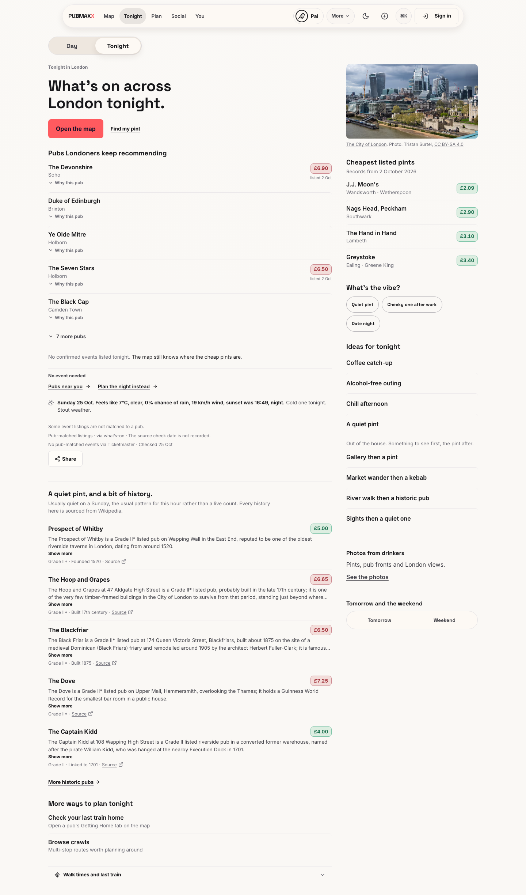
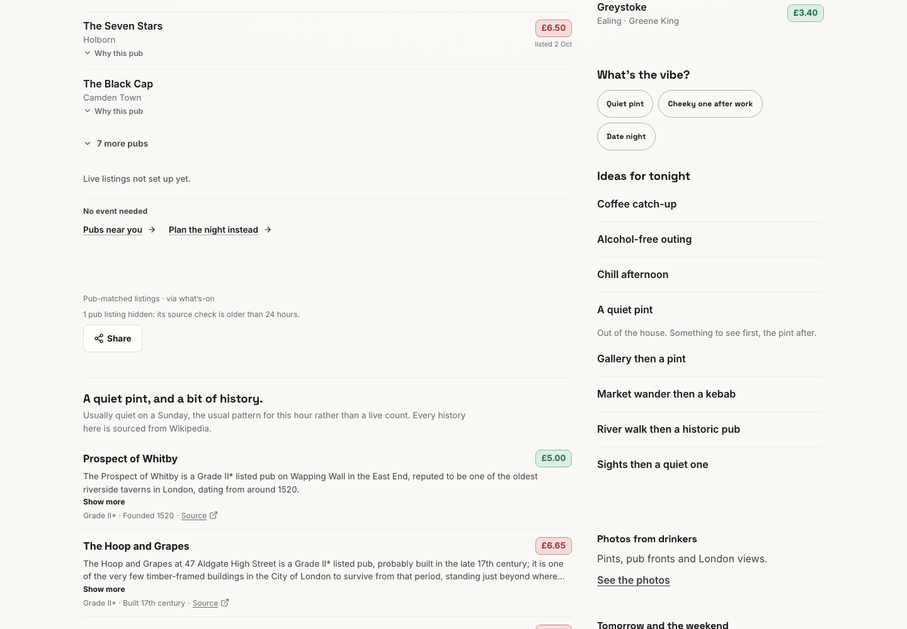
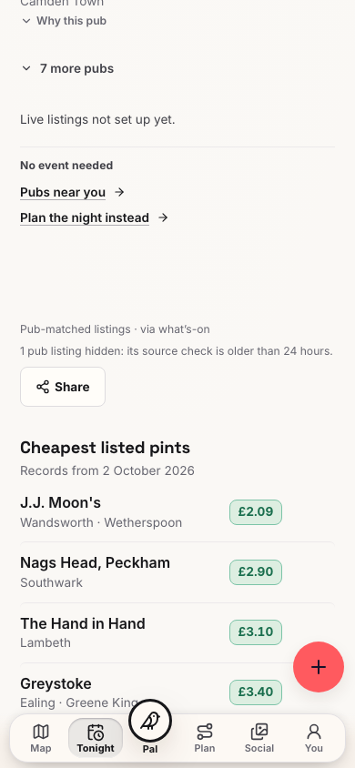

# Tonight source exclusions, 25 October 2026

Before: signed-out production at `a87240e748c859556b3604db508db257af96ca03`.
After: local development server on port 3463 at
`761ba9041`, with no production credentials. Chromium used desktop 1440×1000
and mobile 390×844 viewports. These are browser viewports, not physical devices.
All browser non-GET requests were blocked before navigation.

The source bundle carries Cask's 25 October music listing with a 7 October source
check. The 24-hour freshness rule excludes that listing in both versions.
The changed page says why the listing is hidden. It no longer describes that
old recorded check as an absent check.

| Before | After, desktop | After, mobile |
| --- | --- | --- |
|  |  |  |

The local environment has no configured live listings provider. Its provider
availability message differs from production. The source exclusion and its
visible explanation are the comparison under test.

The targeted Vitest run passed 103 tests across `tonightFreshnessExplanation`,
`tonightOutListings`, `tonightPubSurface` and `voiceComplianceAudit`.
Two additional rendered assertions failed before the stale-versus-missing
correction and passed after it. Changed-file ESLint and `git diff --check` passed.
Production-build validation and hosted checks are reported separately by the PR.

## Review correction

The review correction preserves missing-date messages for displayed undated
listings. It also prevents an accepted listing's stale or undated duplicate
from increasing the hidden count. The merge keeps its existing winner rules.

The rendered regression fixtures cover a CityMCP food offer without `asOf`
beside stale Cask music. They also cover duplicate orderings, a displayed Out
duplicate, and a dated listing beside an unrelated stale exclusion.

The later `tonightExclusionsClient` fixtures render `TonightClient` with stale
Cask listings beside failed, degraded, or pending Out reads and unavailable venue matching.
The [browser regression](../../../e2e/tonight-exclusions.spec.ts) exercises the
page's real fetch hooks at desktop and mobile widths with intercepted responses.
These fixtures do not establish live provider availability or a hosted preview's status.

During the first review, the worktree lacked dependencies. That review could
not run its new regressions or capture mixed-feed screenshots. The screenshots
above remain historical stale-only evidence. They do not prove the later review
corrections. The outer run owns subsequent test results and browser evidence.
