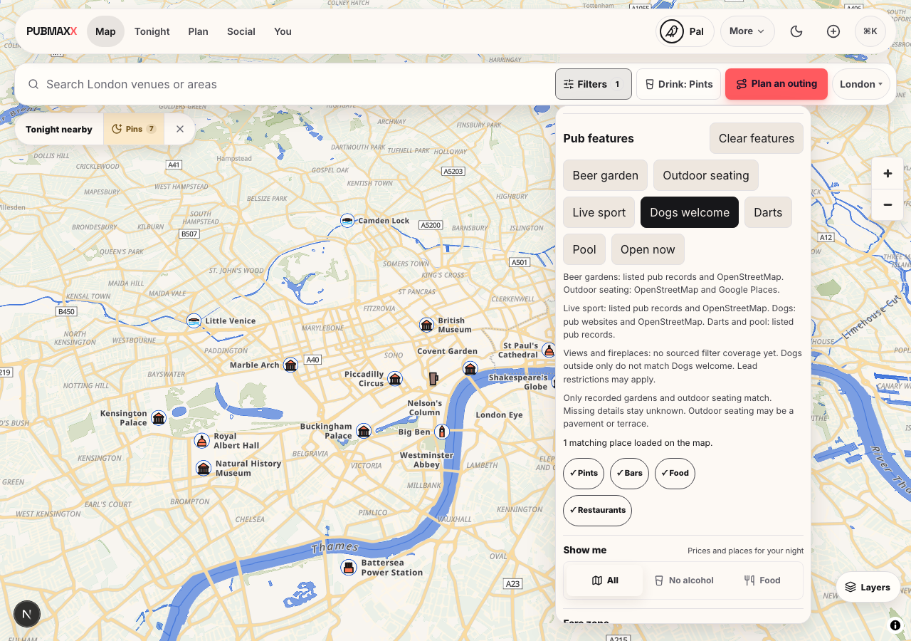
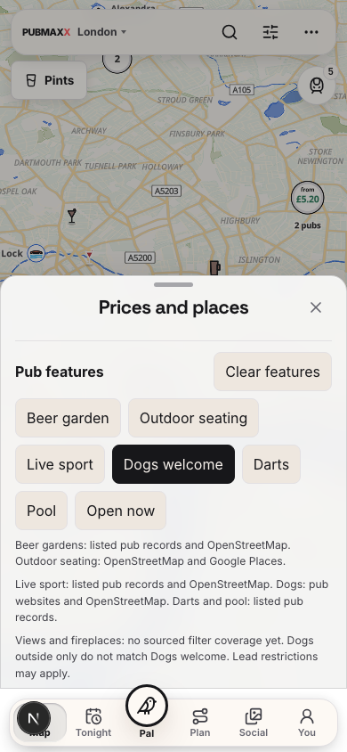

F12 sourced venue features

Worktree: /Users/karanmanoharan/.codex/worktrees/battle-venue-features-1025/pubmaxx
Branch: codex/battle-venue-features-1025
Base: a87240e748c859556b3604db508db257af96ca03
Implementation snapshot: d0d19c186. Later review fixes are not covered by these browser images.

Added Live sport, Dogs welcome, Darts and Pool beside existing garden, outdoor and open-now choices. Views and fireplaces explicitly remain unavailable. No source fetch, migration, deployment or production write occurred.

Current committed London slim filter matches: 512 sport, 78 dogs, 69 darts, 68 pool. These are whole-pack counts, not viewport totals. OSM sports and dog policies keep source dates. Website dog rows keep their original read dates. Outside-only dogs do not match. Explicit no values override positive hints after hydration. Sport without named source cannot match a slim positive filter. Listed darts and pool use existing named pub record fields.

The slim builder keeps its original 21 October generatedAt and revision. Optional false sport bits are omitted so all source/date tuples fit under the existing payload ceiling. Total shard payload: 1190.7 KB / 1200 KB. No ceiling change.

Regression: two new public filterMapVenues tests failed before the implementation. Both passed afterwards. Final targeted run: 148 tests across five files passed. Changed-source ESLint and TypeScript checks passed. Full verify and no-mistakes remain pending coordinator scheduling.

Browser: local Next dev server on private port 3217, own worktree and node_modules. Headless Chromium, 1280x900 desktop and 390x844 phone. Both opened Filters, selected Dogs welcome, observed pressed=true, then Clear features reset pressed=false. Screenshots desktop-after.png and mobile-after.png show the rendered controls and source/unknown copy at that snapshot. No production browsing occurred. The committed initial closed-controls screenshot is [before-arrival.png](before-arrival.png). The tests are the reproducible before failure evidence.

The before image records the original arrival with the filter panel closed. It does not prove the missing controls visually. The failing regression tests prove the original sport bypass and missing dog filter. After images show the open controls. Browser shots occurred during implementation before the final source-validation change. The final targeted tests ran afterwards.

