# Writing and visual refresh

Base: `1dd819f3c`, current `origin/main` when this work started. The owner chose
an independent refresh, separate from open PRs #2347, #2339 and #2346. Those PRs
required reconciliation for homepage copy, Tonight credits, area availability
and About schema. The 25 October receipt below records the reconciled base.
This change does not deploy production.

## Current run receipts on 25 October 2026

Run `01M5R6J0E379W9P7JHP7CETH8F` tested
`58d4c36eca0d5eac525ba7b60218b0f02a74dd40` against
`0bb6fa2e4c0c04ac26db4a1b95305f2d47fb0559`.
Product source is unchanged from `aacd8818884146464d57d2818158929535d61ff0`.
The [current Test report](production-acceptance-01M5R6J0E379W9P7JHP7CETH8F.json)
records a fresh production build and runtime checks after the notification correction.
The earlier failed runs below remain historical receipts.

The Test report records these results:

| Check | Result |
| --- | --- |
| Writing, navigation, photography and film regressions | 31 passed |
| Corrected supplemental scenarios | 17 passed |
| Ten page families at three widths in both themes | 60 passed |
| Historic keyboard controls at 320, 390, 768 and 1440px with 200% text | 8 passed across both themes |
| Pub Pal layout, onboarding and draft restoration | 6 passed |
| Pub Pal voice and memory choices | 2 passed across both themes |
| Today and Tonight sourced fallback parity | Passed |
| Settled Map and Plan controls, expired Discover coverage and About disclosures | Passed |
| OIDC credential precedence, environment fallback and missing-credential refusal | Passed |
| Served photograph formats, dimensions and private metadata | Passed |
| Focused executable unit tests | 122 passed |

The [current page matrix](production-matrix-01M5R6J0E379W9P7JHP7CETH8F.json)
records each route, width and theme.
The [current performance samples](production-performance-01M5R6J0E379W9P7JHP7CETH8F.json)
passed unchanged ceilings for Home, Pub Pal and About.
Their measured largest contentful paint values were 340ms, 328ms and 308ms, respectively.

The browser was Playwright 1.64.0 with Chromium 156.0.8078.4, revision 1248.
It used an isolated local production build and disposable keyless stores.
Physical devices, real accounts and hosted OIDC issuance remain untested.
Three discarded probe attempts remain disclosed in the Test report.
The corrected probes passed without product changes.

The outer executor supplied a passing `npm run verify:no-mistakes:changed` baseline.
The Test phase did not repeat full verification or static checks.
The 524.1-second full verification receipt below belongs to the previous run.
It is not a receipt for this run.

The report records awaited command sessions and intentional server teardown.
Its final process snapshot contained only the native agent and its parent.
That snapshot precedes agent exit. The outer executor owns the completion verdict.
This document does not claim completed hosted review, CI, a merge or a deployment.
Raw logs and fresh captures remain under
`/Users/karanmanoharan/.no-mistakes/evidence/01M5R6J0E379W9P7JHP7CETH8F/`.
The copied JSON receipts retain their original contents and evidence filenames.

## Historical production acceptance on 25 October 2026

Run `01M5R541JEM1F916H92JH55M2M` tested product code `aacd8818884146464d57d2818158929535d61ff0`
against `0bb6fa2e4c0c04ac26db4a1b95305f2d47fb0559`.
The earlier overlapping PRs are included in that base.
Both original and rebased refresh histories remain preserved.
The writing/layout and photography/film commits remain separate.

The full local `npm run verify` passed in 524.1 seconds.
It passed 43,852 unit tests, 697 database tests and 10 cleanup checks.
One existing live-provider test was skipped.
Freshness checks reported two stale-data advisories and three unmeasurable store feeds.
Those feeds are not reported as fresh.

Fresh production output passed the following checks:

| Check | Result |
| --- | --- |
| Writing, navigation, photography and film regressions | 31 passed |
| Extra keyboard, location, photo and recovery scenarios | 14 passed |
| Ten page families at three widths in both themes | 60 passed |
| Historic controls at 320, 390, 768 and 1440px with 200% text | Passed in both themes |
| Home, Pub Pal and About performance ceilings | Passed without budget changes |
| Image formats, credits, dimensions and private metadata | Passed |
| Pub Pal onboarding, draft recovery and delayed visible image layout | Passed |
| Actual OIDC credential precedence and missing-credential refusal | Passed |

The measured LCP values were 340ms for Home, 328ms for Pub Pal and 300ms for About.
These are local Chromium measurements, not physical-device results.
The browser was Chromium 156.0.8078.4 with Playwright 1.64.0, revision 1248.
The application used disposable keyless stores.
No real account or hosted OIDC issuance was tested.

The [production receipt](production-acceptance-20261025.json) records the test commands,
corrected disposable drivers, cleanup and limitations.
The [page matrix](production-matrix-20261025.json) records each route, width and theme.
Two initial driver failures remain disclosed in the receipt.
One used an ineffective native-select key sequence.
The other waited for lazy images outside the viewport.
Corrected tests passed without product changes.

The gate still rejected native Test completion after these product checks passed.
The process trace identified the desktop turn-ended notification helper at agent exit.
The supported headless-worker override now disables that optional notification.
All validation and process-completion checks remain enabled.
The current run above supersedes the pending runtime checks for this historical head.
This failed run does not establish a completed gate, hosted review or CI result.

### Historical page captures at `aacd88188`

The initial before captures below use `1dd819f3c`.
These production captures use `aacd88188`, which also includes later main changes.
They do not attribute every visible difference to this refresh.

| Page | Starting capture | Production capture at `aacd88188` |
| --- | --- | --- |
| Home | 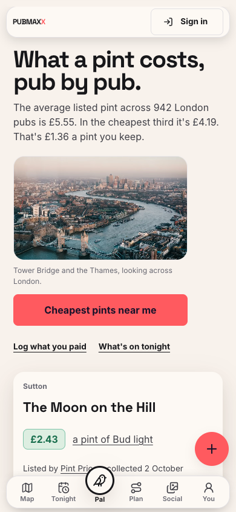 | 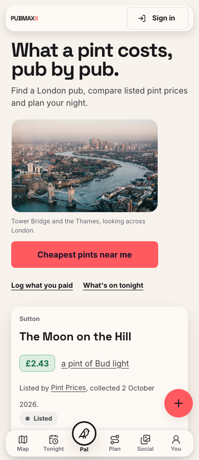 |
| About | 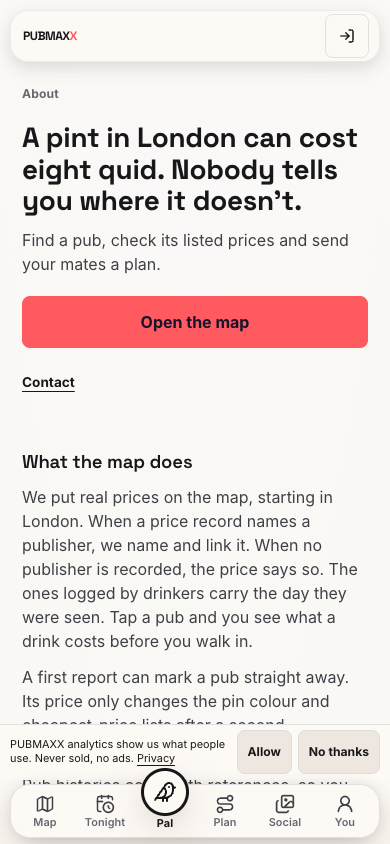 | 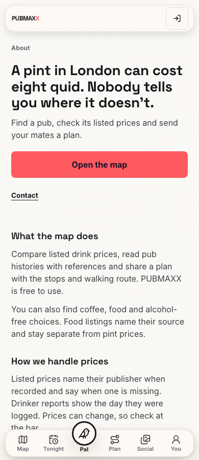 |
| Pub Pal | 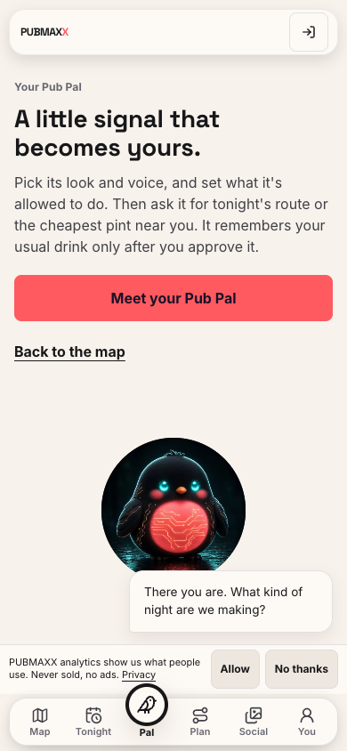 | 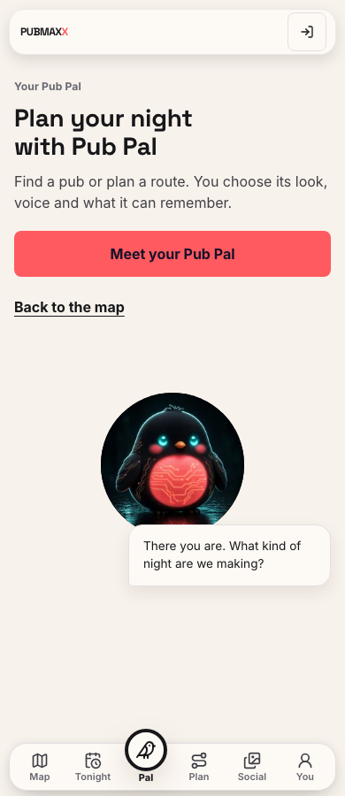 |

Additional phone captures cover [Tonight](production-tonight-phone.png),
[Today](production-today-phone.png), [Discover](production-social-tab-discover-phone.png),
[Plan](production-plan-phone.png), [Map](production-map-phone.png),
[Historic](production-historic-phone.png) and [Southwark](production-borough-southwark-phone.png).
The local visual review retains 42 matched comparisons across both themes and all three widths.

### Historic filter regression

At 390px and 200% text, the borough selector extended 82px beyond the viewport.
The field and selector now fit their available width.
Browser tests check control bounds, touch height, page overflow and focus in both themes.
The extra interaction checks select Southwark and sort the results by keyboard.

| Before at 200% text | After at 200% text |
| --- | --- |
| 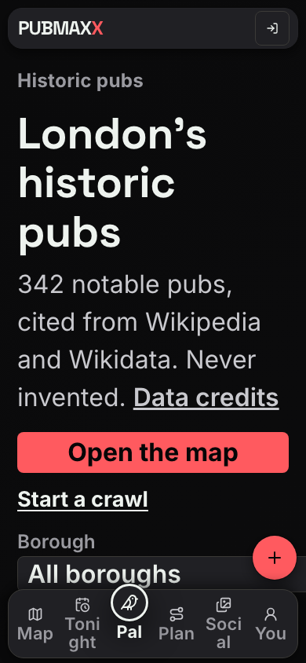 | 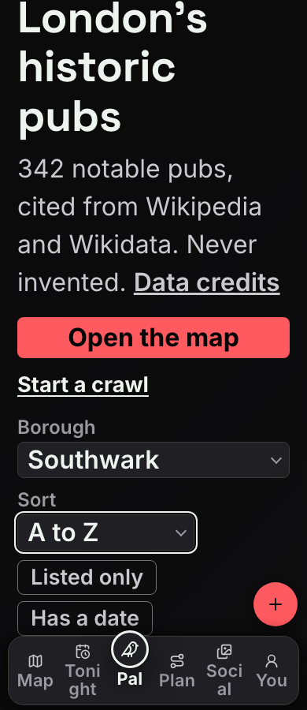 |

The before capture uses `96aeb6bf3`. The after capture uses `aacd88188`.
The after capture includes the selected Southwark state from the keyboard check.

## Historical review fix round on 24 October 2026

This round starts at `1b66ce553f9b1e42842fc155e493d0c1b944a597`, against
base `0bb6fa2e4c0c04ac26db4a1b95305f2d47fb0559`.
The changes were uncommitted when this historical round was recorded.
The current run above supplies later runtime evidence.
The missing-browser observations below describe this round only.

### Navigation spacing

The five navigation tabs and the Pal control now constrain their label widths.
Labels wrap when enlarged text needs another line. Page clearance reserves that
space. Native large-text mode retains its existing icon-only controls.
Destinations, accessible names, safe areas and the equal-column highlight remain.

The browser regression measures each rendered text line against its control
and every sibling label. It also checks text scaling, touch targets, destinations
and page clearance at 320px and 390px, in both themes, at 100% and 200% text.
The production-page browser checks did not run in this round.
Chromium headless shell revision 1248 was absent then.
No browser was installed and no replacement executable was searched for.
The earlier 9.59px overlap remains historical failure evidence.
This round does not claim a fresh visible reproduction or a browser pass.

### Borough photography

The executed Southwark page reproduced the wrong photograph and licensed credit.
The page now uses the shared place-photo resolver and renderer.
Southwark selects the founder's Shard photograph. Camden retains its licensed
photograph, and boroughs without a photograph retain the credited London fallback.
The borough index remains photo-free. Responsive formats, source dimensions and
priority loading remain explicit. The existing 260px frame ceiling remains.

The composition regression renders the actual async page and checks its output.
It checks Southwark's credit, place, alt text, formats, dimensions and priority.
It also checks the licensed Camden path and the London fallback.
A separate browser regression checks the Southwark image actually decodes.
That browser regression did not run in this round because Chromium was absent.

### Dependency repair

The direct `@vercel/oidc` dependency is pinned to `3.2.0`.
The ineffective scoped `@vercel/cli-config` Zod override is removed.
Npm regenerated the lockfile and installed the declared dependencies.
The OIDC token tests execute the installed package and check request precedence,
environment fallback inside and outside a request, and missing-token errors.
The focused verification passed 56 tests in four files with one worker:
`boroughPhotoComposition`, `landingPhotoRender`, `placePhoto` and `searchProvider`.
The Southwark composition test failed before the fix and passed afterward.
Local command receipts are in `artifacts/review-fixes/`.

`npm ls` confirms both OIDC consumers use `3.2.0`, with no installed
`@vercel/cli-config`, and retains `body-parser@2.4.0`.
Inspection of the 15 installed OIDC runtime modules found no CLI configuration
or Zod references. The package declares no runtime dependencies.
`npm audit --json` reports zero findings. The audit alone is not runtime proof.
`git diff --check` passed.
This review phase did not run the full test suite, lint, a production build,
hosted checks, a push or a deployment. The outer executor owns those phases.
Physical-device and real-account coverage remain unverified.

## Historical warm-cache test correction

This historical correction passed all existing ceilings for Home, Pub Pal and About.
Playwright routing disabled the HTTP cache, so discarded warm-up loads could not warm the static assets.
The measurement helper now uses browser-native blocking for third-party requests.
It preserves the HTTP cache, service-worker isolation, CPU throttle, network profile and sample counts.
Product copy, styles and behavior remain unchanged.

| Route | Paint ceiling | Before cache correction | After cache correction |
| --- | ---: | ---: | ---: |
| Home | 800 ms | 984 ms | 248 ms |
| Pub Pal | 700 ms | 852 ms | 212 ms |
| About | 500 ms | 856 ms | 220 ms |

These figures use the same production build from `b44976e23` before and after the helper correction.
They are not a new comparison against the base commit.
Script sizes and request counts remain unchanged in these samples.
[The receipt](gate-cache-correction.json) retains every sample, ceiling and open map-prefetch stream.

The cache regression failed before the fix and passed afterward.
The browser checks also confirm third-party blocking and service-worker isolation.
All six measurement-helper unit tests pass.
The historical dependency audit passed after the body-parser update and scoped Zod override.
That audit did not establish remediation of Zod bundled inside CLI configuration code.
This test phase did not run the full suite, lint or separate static checks.
The outer executor owns those phases and the remaining delivery decisions.

## Earlier gate test corrections

These earlier results cover the working changes after `0cf756fab`, against base source `1dd819f3c`.
Before the cache correction, the performance verdict was **no-go** on this machine.
The isolated comparison found no change-caused slowdown, but both builds exceeded the unchanged paint ceilings.

| Route | Paint ceiling | Standalone change | Alternating change | Alternating base |
| --- | ---: | ---: | ---: | ---: |
| Pub Pal | 700 ms | 844 ms | 856 ms | 844 ms |
| About | 500 ms | 852 ms | 860 ms | 852 ms |

[All standalone samples](gate-performance.json) and the [controlled comparison](gate-performance-ab.txt) retain the failures.
Both browser contexts blocked service workers, which cache pages.
Earlier samples allowed workers to change caching, request counts and navigation timing between measurements.
The corrected tests prevent that contamination. They keep every existing ceiling and assertion.

The Discover badge now uses the existing positive ink token. Its previous light-theme contrast was 2.37:1.
The new browser regression passes at 390, 768 and 1440 pixels in both themes.
The missing `@types/jsdom` dependency now supplies the declarations required by the rendered copy tests.

The shared mascot size list now includes 256 pixels for every species and both image shapes.
The files derive from existing published 512-pixel PNGs with the existing encoder settings.
The phone regression decoded 512 pixels before the fix and 256 pixels after it.
The selected robin WebP falls from 21,724 to 8,422 bytes. Its decoded pixel count falls by 75%.
All 28 added renditions decode at 256 by 256 pixels without camera metadata.
Larger renditions, dimensions, artwork, crops and motion keep their existing behavior.

Historical public captures from this round show [Pub Pal at 390 by 844 pixels](gate-pal-phone.png) and [Discover at 1440 by 900 pixels](gate-discover-desktop.png).
Both captures use Chromium, the light theme and the initial public state.

Focused verification passed 64 unit tests, 11 layout and contrast checks, and the service-worker isolation regression.
The image and worker regressions each failed before their fixes and passed afterward.
The isolated production build completed for browser testing.
Temporary servers, downloaded browsers, disposable drivers and build outputs were removed after testing.
The outer executor owns static checks, broad regression, PR and CI phases.
These results do not establish performance acceptance, account verification, merge readiness or a production release.

## Stage 1

The homepage introduces its task in one sentence. Measured savings and their
dates appear together below the main answer. Historical prices retain their
source and comparison limits inside an Earlier prices disclosure. About keeps
its source policy, confirmation rules, founder quote and press kit, with optional
background folded away. Pub Pal names its purpose and setup choices directly.
Area coverage describes available actions while keeping the eligibility checks.
Source dates use Records from in the existing shared formatter.

The local better-writing skill now starts with docs/VOICE.md, checks a whole
page for repetition and requires a rendered review. Legal meaning, permission
copy, quoted sources and user posts remain protected.

## Coverage inventory

| Family | Copy and states | Treatment |
| --- | --- | --- |
| Home | Intro, prices, history, missing prices, savings, footer, FAQ | Edited and covered by rendered unit tests |
| Today and Tonight | Recommendations, empty listings, source dates, unavailable sources | Copy edited, provider decisions retained |
| Social and discovery | Tab headings, area availability, public lists, signed-out boundary | Headings and coverage copy edited |
| Pub Pal | Meeting, age check, appearance, voice, permissions, memory | Meeting and setup labels edited, existing interaction tests retained |
| Map and nearby | Search, filters, venue sheets, price records, location refusal | Existing routes and controls retained, shared date caption simplified |
| Plan and shared plans | Intake, result, unavailable plan, sharing | Existing concise controls retained |
| Borough, area, drink and historic pages | Place images, prices, source links, empty records | Media reviewed in stage 2 |
| About | Description, source policy, founder, figures, press, attribution | Repetition removed, disclosures added |
| Account, sign-in and onboarding | Authentication, consent, account deletion | Existing copy and behaviour retained |
| Messages, moments and profiles | Private content, public posts, empty and error states | User content retained |
| Invites, rounds and bar tabs | Invitation, joining, shared totals, missing or expired links | Existing routes and state copy retained |
| Activity, updates, wall and founders | Personal activity, public updates, recognition, empty lists | Existing copy retained |
| Venue, ledger, landmark and crawl records | Record details, source credits, missing records, unavailable reads | Existing routes and recovery retained |
| Price index and reference pages | Dates, methodology, source data | Shared date caption simplified |
| Legal and credits | Privacy, terms, attribution | Retained |
| Feedback and contributions | Forms, validation, confirmation | Retained |
| Administrative and integration pages | Moderation and API information | Outside the public visual refresh |

The route list below records the public page templates. The following tables
record shared components and application states, including templates retained
without a copy change. Inventory coverage does not mean browser verification.

### Shared components and metadata

| Component family | Owned surfaces and states | Treatment and evidence limit |
| --- | --- | --- |
| Navigation | `SiteNav`, `SiteNavMore`, `MobileTabBar`, `NowSegment`, landing header and footer | Destinations, active states, theme and sign-in controls retained. Existing public captures show navigation on the sampled pages. |
| Shared actions | `CreateFab`, `PalNavButton`, `MessagesLink`, `NotificationBell`, command palette | Creation, Pub Pal, messages, notifications and search retained. No real account notification or unread state was browser-verified. |
| Page and control primitives | `Screen`, `Kicker`, buttons, tabs, chips, rows, search fields, sheets, `EmptyState`, `PintLoader` | Existing tokens and components retained. Changed pages use the existing hierarchy. Browser evidence covers sampled uses only. |
| Map and venue panels | `MobileMapShell`, `MobileSharedSheet`, venue inspectors, unverified venue sheets, area and food panels | Search, filters, location refusal, absent prices and source links retained. Shared date wording changed. |
| Prices and source credits | `PriceBadge`, `ListedPriceSource`, food and drink menu captions, `dataFreshness` | Price bands, publishers, missing publishers, dates and uncertainty retained. Rendered tests cover changed captions and homepage cards. |
| Root metadata | `app/layout.tsx`, `siteJsonLd`, `app/sitemap.ts`, `app/robots.ts` | Default titles, descriptions, canonical origin, social defaults, structured data and indexing rules retained. No new metadata design. |
| Page metadata | Route `metadata` and `generateMetadata` interfaces across the route list | Home, About and Pub Pal descriptions follow their revised purpose. Other page titles, descriptions, canonical links and indexing policies retained. Metadata tests are separate from browser evidence. |
| Share images and structured data | Home card API, route Open Graph images, `JsonLd` on public records | Home card follows the homepage promise. Existing record cards and source identities retained. Executed home-card tests cover supplied counts and referral redirects. |
| Photography and media | `LandingHero`, `LandingLondonCollage`, `LandingLondonFilm`, listing photo rules | Thames hero retained. Linked photographs and requested film added. Browser evidence covers media loading, focus, reduced motion and failure recovery. |

### Loading, failure and missing records

| Template or state | Treatment | Evidence limit |
| --- | --- | --- |
| Global loading | There is no root `app/loading.tsx`. Root layout suspense reserves mobile navigation space and renders no page-wide loading text. | Source inventory only. No new global loading template added. |
| Route loading | `app/map/loading.tsx` uses `MapLoadingSkeleton`. Feed and Social use `RouteLoadingShell` with their own labels. | Existing loading labels and accessible busy states retained. No new browser coverage claimed. |
| Page render failure | `app/error.tsx` keeps retry, home navigation and the error reference. | Existing recovery retained. No forced browser failure claimed. |
| Root layout failure | `app/global-error.tsx` keeps its own document, system theme, retry, home link and reference. | Existing recovery retained. No root layout crash was browser-verified. |
| Missing page or record | `app/not-found.tsx`, crawl and shared-plan not-found templates | Existing map, Tonight and record recovery links retained. Inventory only. |
| Unavailable record read | Ledger error boundary, `VenueReadUnavailable`, `PlanReadUnavailable` | Existing unavailable-read explanations and recovery retained. An unavailable read remains distinct from an absent record. |
| Empty or failed content lanes | Today and Tonight picks, Social, Stories, messages, prices and public record lists | Existing empty and failure distinctions retained. Today renders ready and degraded reads in unit tests. No live provider outage claimed. |
| Media failure | Optional homepage film failure and retry | Existing stage 2 browser checks cover this state. Other retained media fallbacks received no new browser proof. |

### Onboarding, permissions and account states

| Journey | States inventoried | Treatment and evidence limit |
| --- | --- | --- |
| First run | `/onboarding`, `FirstRunOnboardingGate`, `FirstRunOnboarding`, `OnboardingPanels`, `FirstRunTour` | Native handoff, web eligibility, loading, budget, location, results, skip and completion retained. Existing test-provider evidence is not physical-device proof. |
| Sign-in and account setup | `/login`, `/signin`, `LoginPage`, `AccountOnboarding`, contribution gates | Sign-in alias, account creation, return destination, session hints, handle availability, validation and recovery retained. No real authentication-provider session verified. |
| Consent and permissions | `AnalyticsConsentPrompt`, location controls, Pub Pal microphone controls, deferred install and push prompts | Explanations, accept/refuse choices and recovery retained. Pub Pal setup labels clarified. Native permission dialogs received no new device proof. |
| Pub Pal saved state | Appearance, age check, voice, memory review, confirmation and deletion | Existing controls and eligibility retained. Existing interaction tests support the controls. No real saved backend memory verified in a browser. |
| Account and profile | `/profile`, `/u/[handle]`, `PubmaxxAccountHub`, public account-deletion page | Own and other profiles, signed-out prompts, loading, unavailable accounts, settings and deletion confirmation retained. No real account deletion performed. |
| Private and social content | Messages, activity, Social crews, moments, public posts and profile lists | Signed-out, loading, empty, unavailable, signed-in and user-authored content retained. Social tab headings changed. No real inbox, crew or private content browser verification claimed. |
| Shared night and return | Plan collaboration, invites, rounds, bar tabs, recaps and night memories | Guest and account participation, pending joins, unavailable links, saved plans and return states retained. No durable backend transition browser-verified. |

These entries record treatment and evidence limits for the refresh. Real
signed-in backend states and dynamic URLs remain outside the browser proof.

## Historical evidence from the original refresh

These captures predate the rebase and later gate corrections.
They do not validate the current head.
Matched baseline and original refresh captures are under `artifacts/writing-refresh/`, with
seven page families at 390, 768 and 1440 pixels in both themes. The baseline and
final builds use the same Playwright environment on private ports 3199 and 3198.
Earlier development captures remain diagnostic only. Both builds use test
provider configuration, not a real signed-in account.

| Page | Before | After |
| --- | --- | --- |
| Homepage |  | 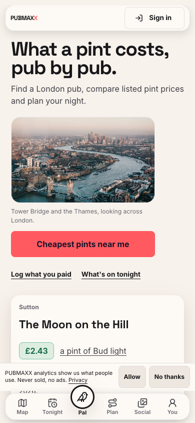 |
| About |  | 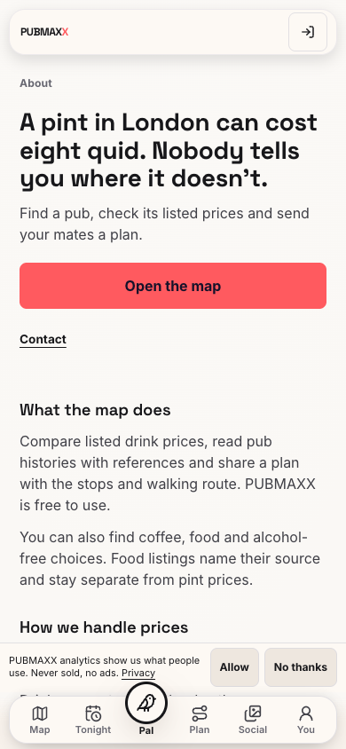 |
| Pub Pal |  | 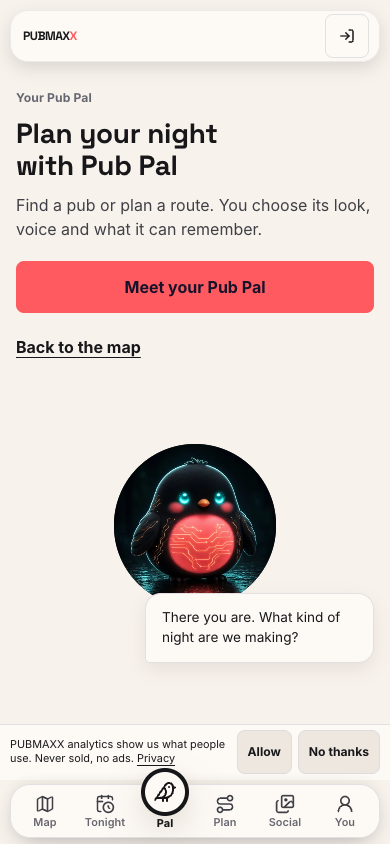 |

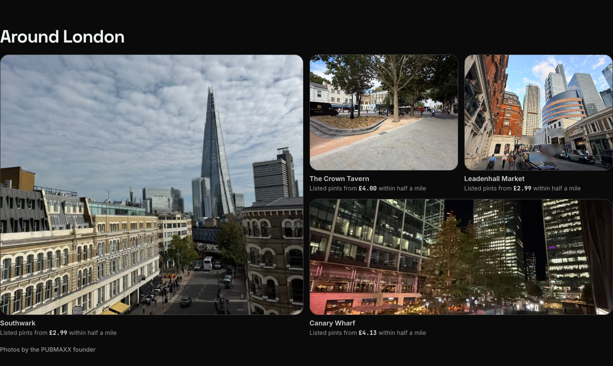

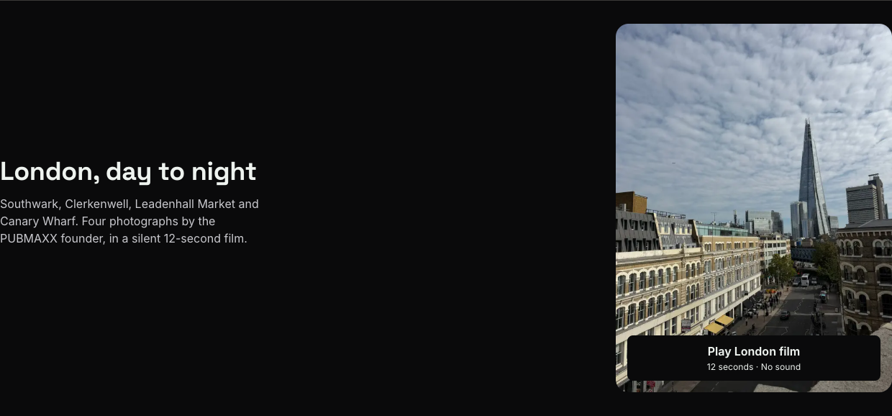

The original production build passed. Nine additional accessibility, keyboard and
reduced-motion checks passed. The focused Chromium run passed all 32
checks across the new journal/film suite and the existing homepage, photography
and Pub Pal layout suites. It covers 390, 768 and 1440 pixels in light and dark,
reduced motion, keyboard playback and disclosures, stable media dimensions,
no video request before Play, and media failure recovery. A separate 200% text
check found no horizontal overflow on the seven reviewed page families.

## Stage 2

Around London uses four existing founder photographs. Southwark, Leadenhall
Market and Canary Wharf link to map searches. The Crown Tavern links to the
Clerkenwell venue, not the pub with the same name in Lewisham. Existing photo
rules also use the relevant images for Southwark borough records and Crown
Tavern historic records. Tonight now enumerates supported London areas through
the photo resolver, so its client receives the founder's Canary Wharf photo.
Wider-area images retain their area labels.

The review regression first reproduced the missing Canary Wharf client input.
`__tests__/tonightInitialOutAnswer.test.tsx` executes the server page and checks
its photo props, including every licensed area photo and the London fallback.
This correction adds composition coverage, with no new browser or account
verification claim. The recorded browser and performance results describe
the original refresh.

The optional film uses these same four privacy-edited photographs. It has 288
frames at 24 fps, runs for 12 seconds and contains no audio. The H.264 file is
1,675,670 bytes at 720 by 960 pixels. Existing AVIF and WebP images supply the
poster. No video element or media request exists before Play. Playback has
native controls, place captions, keyboard focus and an error retry. Reduced
motion keeps the poster static until the reader requests playback.

## Historical repository verification on 23 October 2026

`PUBMAX_VERIFY_COMMITTED_DATA=1 NEXT_PUBLIC_SW_VERSION=local npm run verify`
passed on 23 October 2026. The coverage run passed 43,521 tests in 2,104 files,
with one existing skipped test/file. PostgreSQL permission and migration tests
passed 681 tests in 74 files. The separate harness checks also passed.
Lint, database types, TypeScript, dead-code checks, data validation, install
policy and the dependency audit passed. Freshness reported two stale datasets
and three unmeasurable store feeds as advisory findings. They are not claimed
fresh. The full log is `/tmp/pubmaxx-writing-verify-complete.log`.

## Performance

The first ad hoc measurements used the fallback harness timing boundary and
reported JavaScript budget breaches on Home, Pub Pal and About. The repository's alternating A/B check then measured the
branch and its exact base on the same machine. Each arm supplied three samples.

| Route | Base decoded JS | Refresh decoded JS | Existing ceiling |
| --- | ---: | ---: | ---: |
| Home | 856 KB | 858 KB | 1,010 KB |
| Pub Pal | 915 KB | 915 KB | 1,050 KB |
| About | 771 KB | 771 KB | 960 KB |

The A/B classified all three as no slower than base and reported timing drift
in the earlier measurement. This comparison does not waive a budget gate or
prove performance on routes it did not measure. No ceiling was raised. The scoped check through the repository Playwright runner then passed every
metric for all three routes with the page-ready boundary. It recorded no
breaches and no unmeasured metrics. The [final samples](performance.json) are
attached. The original fallback result remains in the local artifacts directory.
The [A/B report](performance-ab.txt) records the method and verdict.

## Review

### Standards

The independent standards review found that the journal link label hid its
price caption from the accessible name. The link now uses its visible caption,
including the listed price and half-mile qualification, as its accessible name.

### Specification

The independent specification review found that a ready-area link promised an
area-specific planner, but opened the general planner. Its label now says
Open planner. The destination and eligibility rules are unchanged.

## Delivery checklist

- [x] Keep the original routes and navigation destinations.
- [x] Preserve price qualifications, credits, consent and recovery text.
- [x] Keep the Thames hero and existing design tokens.
- [x] Inventory public route templates and record unchanged families.
- [x] Keep the local writing skill specific to PUBMAXX.
- [x] Separate copy/layout and photography/film in distinct commits.
- [x] Include requested playback, reserved media dimensions and failure recovery.
- [x] Complete the performance comparison and scoped budget checks.
- [x] Record the historical repository verification receipts above.
- [ ] Complete the required publishing gate and hosted review.

Real account sessions, physical devices and assistive-technology software were
not exercised. The browser checks cover the provider-shaped test environment.
These limits remain separate from unit coverage and production release approval.

## Route templates

- `/`
- `/about`
- `/account/delete`
- `/activity`
- `/add-a-pub`
- `/add/[handle]`
- `/admin`
- `/area/[slug]/drink/[brand]`
- `/bar-tab/[id]`
- `/borough`
- `/borough/[slug]`
- `/contributors`
- `/crawls`
- `/crawls/[slug]`
- `/credits`
- `/discover`
- `/drink/[slug]`
- `/drinks`
- `/feed`
- `/feedback`
- `/founders`
- `/historic`
- `/historic/[slug]`
- `/how-we-estimate`
- `/invite/[token]`
- `/landmark/[id]`
- `/ledger/[id]`
- `/login`
- `/map`
- `/map/[city]`
- `/map/arrival`
- `/messages`
- `/messages/[id]`
- `/moment`
- `/near`
- `/onboarding`
- `/p/[id]`
- `/pal`
- `/pal/chat`
- `/pint-index`
- `/pint-index/[month]`
- `/places`
- `/plan`
- `/plan/[id]`
- `/plan/[id]/recap`
- `/price-pulse`
- `/privacy`
- `/profile`
- `/pubs`
- `/pubs/[id]`
- `/recap/[storyId]`
- `/rounds`
- `/rounds/[code]`
- `/signin`
- `/social`
- `/social/crews/[crewId]`
- `/soft-drinks-and-water`
- `/spoons-value`
- `/terms`
- `/today`
- `/tonight`
- `/u/[handle]`
- `/u/[handle]/lists/[listType]`
- `/u/[handle]/people/[relation]`
- `/updates`
- `/wall`
- `/we-are-out`
- `/webmcp`
